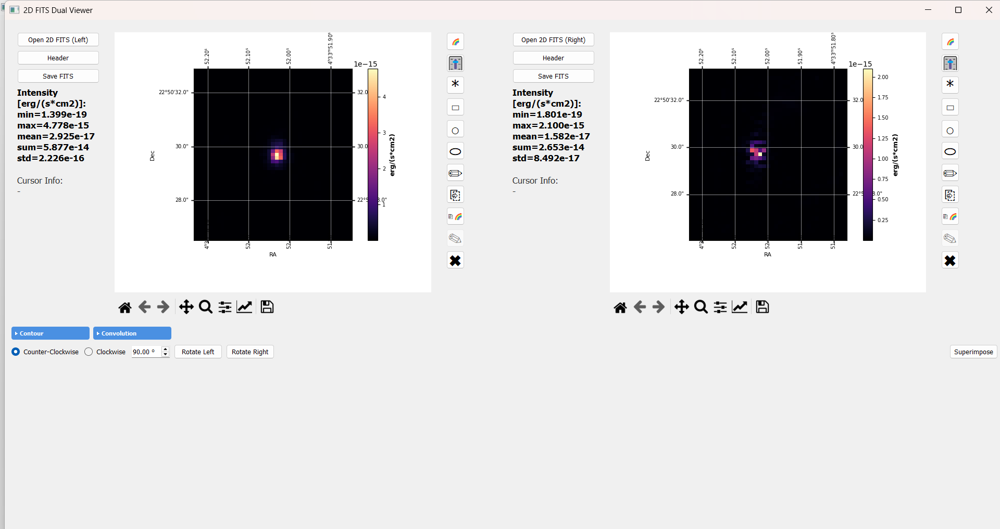
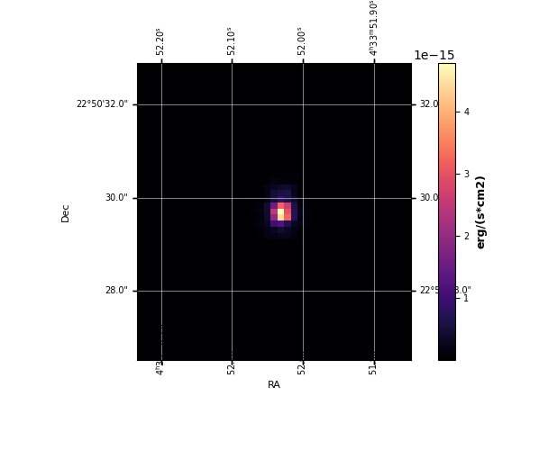
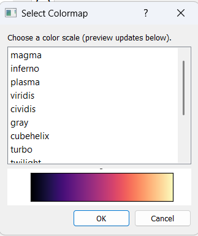
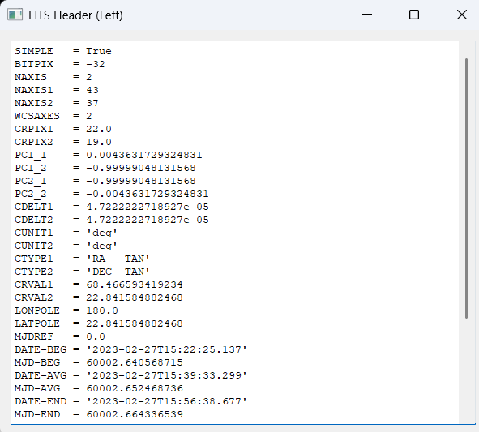
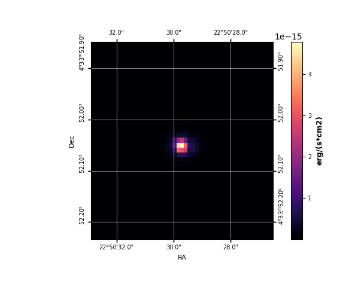
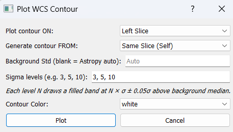
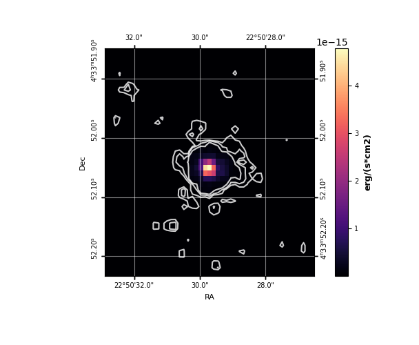
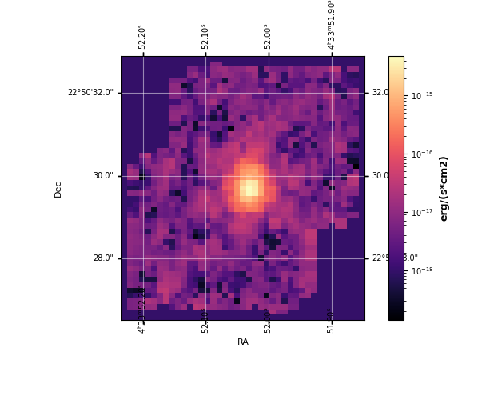
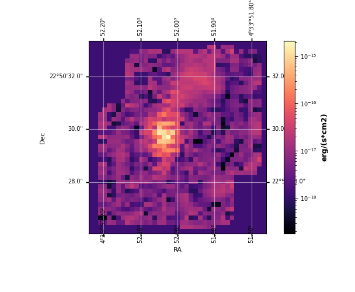
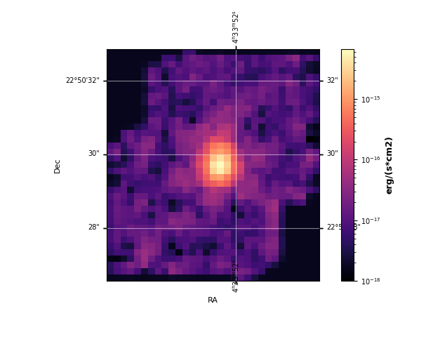

=========================
2D FITS Dual Image Viewer
=========================

The 2D FITS Dual Image Viewer is a standalone side-by-side viewer for
2D intensity maps, moment maps, and derived FITS products. It is fully
WCS-aware, with interactive coordinate display and a full set of
multi-image analysis tools.

This guide walks through every feature of the viewer in the order most
users will encounter them. For a top-level feature summary, see the
2D FITS Dual Image Viewer section of :doc:`../features`.

Launching the viewer
====================

The 2D Viewer can be opened from the main IFU Analyzer window, or run on
its own when no cube is loaded. Either way, you get a dual-panel layout
with **Left** and **Right** image slots that each behave independently.

Image Display
=============

Loading images
--------------

- Click **Open 2D FITS (Left)** or **Open 2D FITS (Right)** to load a 2D
  FITS image into the corresponding panel.
- Each panel keeps its own WCS, scaling, and colormap state — you can mix
  any two images of any pixel scale or orientation.
- A 2D viewer panel accepts any standard 2D FITS image: intensity maps,
  Gaussian-derived maps (peak, sigma, area), moment maps, RGB-channel
  exports, etc.

WCS grid overlay
----------------

- If the FITS header contains a celestial WCS (``CTYPE1``/``CTYPE2`` with
  ``RA---*`` / ``DEC--*``), an RA/Dec grid is automatically drawn over
  the image.
- Tick label format auto-scales to the field of view —
  degrees → arcmin → arcsec → sub-arcsec.
- Tick positions remain correct after any rotation.
- Non-celestial WCS automatically falls back to plain pixel axes.

Cursor readout and statistics
-----------------------------

- Move the mouse over either image and the left side panel shows live:

  - Pixel coordinates ``(x, y)``
  - RA in ``hh:mm:ss``
  - Dec in ``dd:mm:ss``
  - Flux value at the cursor (with the unit from ``BUNIT``)

- The **Image Stats** panel reports min, max, and mean of the displayed
  image, plus the unit string from ``BUNIT``.

Color scale and colormap
------------------------

- Each panel has a **🎚** button that opens a menu with four scaling options:

  - **Linear** — direct mapping
  - **Log** — ``log10`` of the data (useful for faint extended emission)
  - **Sqrt** — square-root stretch (intermediate compression)
  - **Power** — ``data^2`` stretch (boosts high-flux regions)

- Click the **🌈** button on either panel to open the colormap dialog
  and pick any matplotlib colormap. Colorblind-friendly options are
  included.

Header viewer
-------------

- Click **Header** on either panel to open a dialog listing every FITS
  header card for that image. Useful for checking ``BUNIT``, the WCS
  keywords (``CTYPE``, ``CDELT``, ``CD*_*``, ``PC*_*``), and instrument
  identifiers (``INSTRUME``, ``TELESCOP``).

Image Rotation
==============

The Rotation tool turns the image about its centre by any angle while
keeping the WCS correct, so RA/Dec coordinates remain accurate.

Performing a rotation
---------------------

1. Select the direction (**Clockwise** or **Counter-Clockwise**).
2. Enter the angle in degrees (any positive number).
3. Click **Rotate** and pick the panel (**Left** / **Right**) to apply
   the rotation to.

What happens internally
-----------------------

- ``scipy.ndimage.rotate`` is used with ``reshape=True`` and
  ``cval=NaN``. Border pixels created by the rotation are NaN, not zero,
  so they don't contaminate later analysis.
- The CD matrix is updated as ``CD_new = CD_orig × R⁻¹`` where ``R`` is
  the 2D rotation matrix for the opposite of the requested angle.
- ``CRPIX`` is **not** changed — the reference pixel stays anchored to
  the same sky coordinate, so RA/Dec tick labels remain correct.
- Rotations are cumulative — applying 30°, then 30° gives the correct
  60° image (errors do not stack).

Saving the rotated image
------------------------

Click **Save Rotated FITS** to write the rotated image and its updated
WCS header to a new FITS file. The new file is self-contained — you can
load it into the viewer (or any other tool) and the WCS will be correct.

Contour Plotting
================

Generate sigma-level contours from one image and draw them on the same
panel or on the other panel (WCS-matched cross-image contours).

Drawing contours
----------------

1. Click **Plot Contour**.
2. Choose:

   - **Draw on**: which panel to draw the contour overlays on
     (Left / Right)
   - **Source image**: same panel, or the opposite panel for
     cross-image contours
   - **Background std**: leave blank to use Astropy
     ``sigma_clipped_stats`` (3σ clipping) for automatic background
     estimation; or enter a custom value
   - **Sigma levels**: comma-separated list, e.g. ``3, 5, 10``
   - **Contour color**: any matplotlib color string or hex code

3. Click **OK** to draw the contours.

For each level ``N`` in your list, a contour line is drawn at
``median + N × std``, where ``median`` and ``std`` are from the
background statistics.

The result is a contour overlay on the chosen panel:

   
Cross-image contours (WCS-matched)
----------------------------------

When you generate contours from a different panel's image, the contour
vertices are transformed through both images' WCS so they land at the
correct sky coordinates on the destination panel. This works even when
the two images have:

- Different pixel scales
- Different array sizes
- Different orientations

Select **Other Slice (Match WCS)** as the "Generate contour FROM" source, and the contours
match across both panels via WCS.

Stacking and clearing
---------------------

- Multiple **Plot Contour** runs add contour sets on top of each other —
  for example, draw 3σ in white, then 10σ in red.
- Click **Clear Contours** to remove all contour overlays from a panel.

Contour Export / Import
=======================

Once you have a set of contours you like, you can persist them in two
formats: a human-readable text file or a binary FITS mask.

Save contour as .txt
--------------------

- Click **Save Contour Mask** → choose the source panel → enter a
  filename.
- Output is a comma-separated ASCII file:

.. code-block:: text

   # IFU Analyzer 2D - Contour Export
   # level, x_pixel, y_pixel, RA_deg, Dec_deg
   3.000000e+00, 42.1234, 18.7654, 67.90591, 18.20682
   3.000000e+00, 42.5234, 18.6754, 67.90585, 18.20680
   ...

Each row is one vertex on a contour path. The sigma level is the first
column. Pixel coordinates and RA/Dec are included so the file can be
used by any external tool.

Load saved contour
------------------

- Click **Load Saved Contour** → pick a binary FITS mask file.
- Choose the destination panel.
- The mask is reprojected onto the panel's pixel grid via WCS coordinate
  mapping and drawn as an overlay.

Save contour mask as FITS
-------------------------

- Exports a binary 0/1 ``uint8`` FITS image with the WCS header of the
  source panel.
- Use this when you need to feed the contour as a mask into another
  analysis tool.

WCS Superimpose
===============

Overlay two images that have different WCS grids — different pixel
scale, array size, orientation, or pointing — onto a single panel.

Procedure
---------

1. Load one image in the Left panel and another in the Right panel.
2. Click **Superimpose WCS**.
3. Choose:

   - The **background panel** (this becomes the reference grid)
   - The **overlay colormap**
   - The overlay **alpha** (transparency, 0.1–1.0; ~0.5 is a good
     starting point)

4. The viewer reprojects the overlay image onto the background image's
   pixel grid using the project's built-in WCS coordinate transform
   pipeline (no external ``reproject`` package required). Bicubic
   interpolation (``order=3``) is used with NaN-aware masking.

Alignment diagnostic
--------------------

After superimposing, the terminal prints the **peak separation** — the
angular distance between the brightest pixels of the two images, in
arcseconds. Use this to confirm the WCS headers agree:

- ``< 0.5 px`` → good alignment
- Large separation → WCS header discrepancy (check ``EQUINOX``,
  ``CRPIX``, the CD matrix, etc.)

Slides Convolute — pairwise resolution matching
===============================================

Match the resolution of two images so they can be compared pixel-by-pixel.
This is the standard step before any multi-instrument flux comparison
(e.g. MIRI vs NIRSpec H₂ intensity).

Procedure
---------

1. Load both images into the Left and Right panels.
2. Click **Slides Convolute**.
3. A confirmation dialog shows:

   - Which image will be convolved (the finer one)
   - The Gaussian kernel σ in arcsec and in fine-image pixels
   - The output grid dimensions

4. Click **Yes** to run.
5. Choose a save path — the convolved image is written as a 2-HDU FITS
   (image + ``COVERAGE`` extension).
6. The success dialog shows a flux audit: ``Ratio out/in : 1.000000``
   confirms exact flux conservation.

What happens internally
-----------------------

The tool automatically identifies the finer image and convolves it up to
the coarser pixel scale:

- **Kernel width** is derived by quadrature subtraction:
  ``σ = √(σ_target² − σ_input²) / 2.3548`` (in fine-image pixels).
- **Convolution** uses ``astropy.convolution.convolve_fft`` with
  ``nan_treatment='interpolate'`` (NaN pixels — e.g. IFU footprint
  borders — are handled without propagating gaps),
  ``normalize_kernel=True`` (kernel sum is unity, so surface brightness
  is preserved per pixel), and NaN-padding of width ``⌈4σ⌉`` before the
  FFT so kernel tails stay inside the domain.
- A final flux renormalisation guarantees
  ``Σ(output_finite) == Σ(input_finite)`` to machine precision
  (~10⁻⁷ relative error).
- The convolved image is then reprojected onto a new pixel grid at the
  coarse pixel scale using a flux-conserving spherical-polygon
  intersection algorithm (equivalent to ``reproject_exact`` —
  self-implemented; no external ``reproject`` dependency).
- Output shape is sized to fully contain the fine image's original FOV
  so no sky coverage is lost.

Guards and edge cases
---------------------

- **Same-resolution guard:** if both panels have the same pixel scale
  (within 0.0001 arcsec/px), Slides Convolute shows a "nothing to do"
  message instead of running. This prevents repeated unnecessary
  convolutions.
- **No-overlap guard:** if the two images cover completely different
  sky regions, the viewer warns "No Sky Overlap" and refuses to run.
  Load images of the same field.
- **Empty-result postcheck:** if the inputs technically overlap but the
  full-coverage output region is empty (e.g. very thin edge-only
  overlap), the viewer warns and does not save an all-NaN result.

Worked example: MIRI ch1-long (Left) and ch2-long (Right) as the pair, both in log scale:

And the Slides Convolute result -- ch1-long convolved and reprojected onto ch2-long's
(coarser) grid, still in log scale:

Batch Convolution — multi-image resolution matching
===================================================

Bring any number of images to a single common resolution and FOV in one
step.

Procedure
---------

1. Click **Batch Convolution** to open the batch dialog.
2. Use **+ Add FITS Files** to add two or more 2D FITS files. Any mix
   of instruments, pixel scales, and orientations is allowed.
3. Click **Process & Download ZIP**.
4. Choose a save path for the output ``.zip`` file.

The dialog prevents you from launching when the inputs cover disjoint
sky regions — a "No Sky Overlap" warning lists which file pairs don't
share sky, so you can remove the off-field file before retrying.

What happens internally
-----------------------

The tool:

1. Identifies the **worst (coarsest) pixel scale** among all inputs —
   this becomes the target scale.
2. Identifies the **largest-area image** (most sky coverage) to define
   the output orientation and centre.
3. Builds a single common output WCS at the worst scale, sized to cover
   the **union of all input footprints** — no image loses sky coverage.
4. For each input, applies the appropriate Gaussian kernel (σ from
   quadrature) and reprojects onto the common grid.
5. Images already at the worst scale receive ``σ = 0`` (no smoothing;
   only a reproject if needed).

Output
------

- All outputs are packed into a ``.zip`` archive — one FITS per input,
  all on the same WCS grid, ready for pixel-by-pixel comparison.
- Each output FITS includes the ``COVERAGE`` extension (per-pixel
  overlap fraction 0–1).
- The completion dialog shows a flux audit table — every row should
  read ``ratio = 1.000000``. Any large deviation indicates a corrupted
  WCS header in the corresponding input.
- Files that produced an all-NaN frame appear in the audit table with
  ``[EMPTY]`` next to their name; they're skipped in the ZIP so the
  rest of the batch is still useful.

Region Selection
================

The 2D Viewer shares its region-selection code with the main cube viewer (the same
``RegionSelectionMixin``), so drawing, editing, and reading stats back all work the same
way as :doc:`selecting_regions`:

- **Point** — single-pixel readout
- **Rectangle** — axis-aligned box
- **Circle** — fixed-aspect-ratio ellipse
- **Ellipse** — independently adjustable major and minor axes
- **Freehand** — click to add vertices, double-click to close

Once a region is drawn on either panel, statistics appear in the image stats panel: min,
max, mean, sum, std for the pixels enclosed by the region. **Edit Shape** toggles
drag/resize handles and **Copy Color** copies this panel's colormap to the other panel,
exactly as in :doc:`selecting_regions`.

.. note::

   **💾** Export Region (:doc:`selecting_regions`) is main-window only -- it isn't
   available in the 2D Viewer.

**Copy** is the one place behavior actually differs: the two 2D panels can hold images of
completely different pixel scale and orientation (unlike the main viewer's two slices,
which always share one cube's grid), so copying a selection here reprojects its corners
through both panels' WCS -- a rectangle can come out as a rotated polygon on the other
side if the two images don't share an orientation, rather than a plain pixel-index copy.
