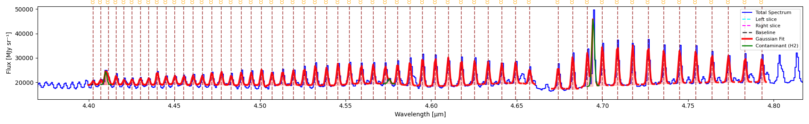
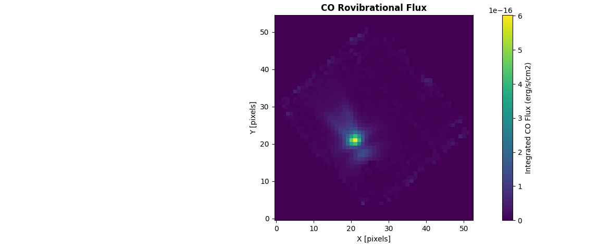
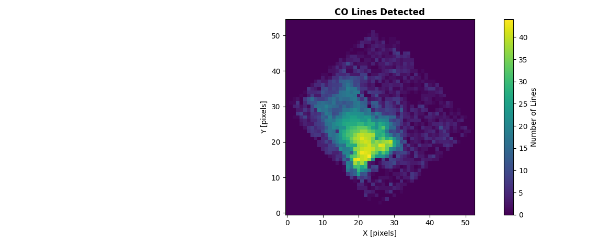
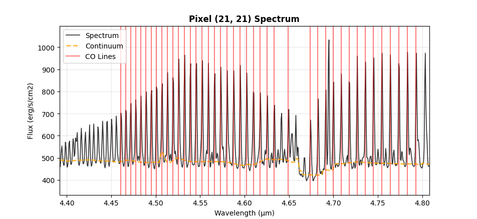

==================
CO Flux Extraction
==================

Extract and measure carbon monoxide (CO) line fluxes from spectral data cubes. This specialized tool analyzes CO emission or absorption across multiple rotational transitions.

Starting CO Flux Extraction
===========================

**Access Tool**

1. Click **HITRAN** menu in toolbar
2. Input min/max wavelengths and click on **HITRAN** button
3. Choose molecule, isotopologue number, and vibrational level
4. (Optionally) Refresh HITRAN query

The spectrum now shows the lines given those parameters.
Hovering over a line shows its species, its wavelength, its transition, and its Einstein coefficients
You can remove a line by clicking on it in the spectrum or by clicking on the **SPECIES** button which renders a table with all the current species.

Load Contaminating Lines
========================

Additionally (and optionally), you can load a catalog of contaminating (non-target) lines
so both **CO Flux Map** and **Multi-Gaussian Fit** (below) can account for them instead of
letting their flux distort a nearby CO line's measurement.

1. Click on **Load Contaminating Lines** and load a .csv file with unwanted lines

IMPORTANT: Make sure this file has a column called 'wavelength'.

Loading the catalog doesn't retroactively update results you've already produced -- run
**CO Flux Map** / **Multi-Gaussian Fit** again after loading it for the fit to pick it up.

Multi-Gaussian Fit
=====================

Fit every currently-plotted HITRAN line at once via linear least squares. Each line's
center is fixed at its catalog wavelength, and its width comes from the instrument's own
spectral resolution rather than being fitted -- these lines are instrumentally unresolved,
so width is a property of the instrument, not something to estimate per line or per fit.
With both fixed, solving for every line's amplitude becomes a single linear solve instead
of an iterative nonlinear one: no risk of a weak line's fit window drifting off it, and
overlapping lines are disentangled correctly because they're all solved for together
rather than one at a time. ``fit_hitran_lines()`` in ``cube_explorer.api`` runs this exact
algorithm (see *Using the API* below); it is not an approximation of the GUI button, the
two share the same code path.

If you've loaded a contaminating-lines catalog (above), any contaminant that falls in the
fitted range *and* is far enough from every requested line (at least ~2σ) gets its own
component too, so its flux is absorbed there instead of leaking into a nearby CO line's
amplitude. It's drawn as a green outline on the plot and listed separately in the results
-- never counted toward the CO line total. A contaminant too close to a requested line to
reliably tell the two apart (<2σ) isn't given its own component; that CO line's result
gets a note instead, flagging the unresolved nearby contaminant rather than reporting an
unreliable split.

1. Perform automatic continuum on the 1D spectrum by clicking on **Continuum Tools → Automatic Continuum → Continuum Line**
2. Click on **Multi-Gaussian Fit**

A Gaussian curve is overlaid on the spectrum for each plotted line, and a results window
opens with one block per line, plus a separate section listing any contaminating lines
that got their own component.

   56 CO v=1→0 lines (4.40–4.80 µm) fitted simultaneously via **Multi-Gaussian Fit** on a
   NIRSpec G395H spectrum. The green curve near 4.69 µm is an H2 line from the loaded
   contaminating-lines catalog, fit as its own component so it doesn't distort the
   neighboring CO lines' amplitudes.

Reading the results
--------------------

Each line's block reports two groups of numbers:

- **Catalog identification** — ``Line λ``, ``Transition``, ``A coeff`` and ``E_upper``,
  copied straight from the HITRAN entry, not measured. Useful for cross-checking that the
  fit actually locked onto the line you think it did.
- **Fitted parameters** — ``Center``, ``Amplitude``, ``Sigma``, ``FWHM``, ``Integrated
  Area`` and ``R²``. ``Center`` is always exactly the catalog wavelength -- it's fixed, not
  fitted -- and ``Sigma`` follows the instrument's spectral resolution rather than varying
  line to line the way a free nonlinear fit's would. Units follow the same rules as the 1D
  page (:doc:`gaussian_fitting_1d`) — ``Integrated Area`` is erg/s/cm² wherever the header
  supports the conversion.

A **CONTAMINATING LINES** section follows the fitted lines whenever any contaminant got its
own component: wavelength, species, amplitude and area for each -- these are not part of
the CO line count or total above.

Using the API
--------------

.. code-block:: python

    from cube_explorer.api import load_cube, fit_hitran_lines
    from cube_explorer.line_catalog import load_contaminating_lines_catalog

    cube = load_cube("data.fits")
    contam = load_contaminating_lines_catalog("path/to/ContaminatingLines.csv")  # optional

    results = fit_hitran_lines(
        wavelength=cube.wavelength,
        spectrum=cube.spectrum,
        molecule='CO',
        wavelength_min=4.40,
        wavelength_max=4.80,
        v_upper=1,              # v=1->0, same filter as the HITRAN dialog
        v_lower=0,
        header=cube.header,     # Required for the erg/s/cm2 conversion
        wave_unit=cube.wave_unit,
        contam_catalog=contam,  # omit (or None) to skip contaminant handling entirely
    )

    detected = [r for r in results if r['success']]
    print(f"Fitted {len(detected)}/{len(results)} lines")
    for r in sorted(detected, key=lambda r: r['wavelength']):
        print(f"  {r['wavelength']:.6f} um  area={r['area']:.4e} {r['area_unit']}  R2={r['r_squared']:.4f}")

.. code-block:: text

    Fitted 56/56 lines
      4.402678 um  area=1.0164e-16 erg/s/cm²  R2=0.3553
      4.407041 um  area=1.2351e-16 erg/s/cm²  R2=0.8765
      4.411493 um  area=1.9398e-16 erg/s/cm²  R2=0.8866
      ...
      4.773583 um  area=6.2902e-16 erg/s/cm²  R2=0.8193
      4.783296 um  area=5.7530e-16 erg/s/cm²  R2=0.5895
      4.793124 um  area=5.8123e-16 erg/s/cm²  R2=0.6617

This reproduces the worked example above exactly: fitted centers, areas and R² match the
screenshot's results window to the last reported digit, because it is the same fit
(``fit_hitran_lines`` is what the GUI button calls). Contaminating lines from ``contam``
that got their own component aren't in ``results`` at all -- they exist purely to keep the
CO lines' amplitudes honest; if you need their values too, they're only currently exposed
through the GUI's results text, not this return value.

.. important::

   As with ``fit_line``, pass ``header``/``wave_unit`` to get ``area`` in erg/s/cm² —
   without them it stays in the cube's native units, and ``area_unit`` always tells you
   which one you got. There is no continuum-fitting step in the example above because
   none was given: leaving ``continuum`` unset fits one automatically with
   ``fit_continuum()``, the same fallback the GUI uses when you have not run **Automatic
   Continuum** interactively. Pass your own ``continuum`` array to use a continuum you
   already fitted instead.

**Analyze CO for All Pixels**

Extract a CO flux map across every spatial pixel:

1. Click on **CO Flux Map**.
2. A popup explains that continuum subtraction runs automatically per pixel, using default
   parameters that work well for typical spectra. Click **No** to use those defaults, or
   **Yes** to open the same parameter dialog as the manual Automatic Continuum tool and set
   your own values instead.
3. A preview shows the brightest pixel within your wavelength range, with the (deduplicated)
   HITRAN lines marked -- a sanity check before committing to a full-cube run. Click
   **YES - Extract Map** to proceed.

If you've already run an extraction with the same wavelength range and continuum choice,
you'll be offered the cached results instead of re-running.

**Progress Monitoring**

The progress dialog updates per pixel as the cube is processed.

**Output Products**

   Integrated CO flux per pixel.

   Number of CO lines detected per pixel, for the same cube. Switch between this and the flux
   map with the **Display** dropdown in the results window.

- **CO Flux Map**: integrated flux per pixel
- **Detection Count**: number of lines detected per pixel
- **Export as FITS** / **Show Statistics** buttons in the results window

**Inspecting Individual Pixels**

With **Pixel Select** on (the default), clicking a pixel on either map opens that pixel's fit:

   Spectrum for an individual pixel, zoomed to the fitted wavelength range, with the fitted
   continuum and each CO line marked in red.

Turn **Pixel Select** off to zoom/pan the map freely instead of reopening this dialog on every
click.

Using the CO Flux API
======================

Extract CO fluxes programmatically for single spectra or full data cubes, using
``extract_co_flux()`` and ``create_co_flux_map()`` -- the same algorithm as the GUI's
**CO Flux Map** button.

.. note::

   This is a **different algorithm** from **Multi-Gaussian Fit** / ``fit_hitran_lines()``
   above, not a scripted version of it, and the two don't produce identical totals for the
   same spectrum -- expect them to land within roughly 10-20%, not match exactly.
   ``extract_co_flux``/``create_co_flux_map`` fit every line in a 0.1 µm wavelength chunk
   *simultaneously* against one shared local continuum, via nonlinear least squares
   (``curve_fit``), and only count a line if it clears a per-pixel signal-to-noise
   threshold first (``snr_threshold``, default 3σ). ``fit_hitran_lines`` fits every
   requested line at once via linear least squares with fixed centers/widths, with no SNR
   gate at all -- it fits whatever you selected, weak lines included.

   The gap between the two is usually dominated by that SNR gate, not a disagreement about
   the underlying signal: CO Flux Map fits pixel-by-pixel, and a real but weak line often
   can't clear 3σ in any single noisy pixel, so it contributes nothing to that pixel's
   flux. ``fit_hitran_lines`` fits one combined, much higher-SNR spectrum directly, so it
   can recover that same real flux. Summed over many pixels this adds up to CO Flux Map
   running systematically lower. Lowering ``snr_threshold`` narrows the gap, but that's
   trading a real problem (missing weak, real flux) for a different one (counting noise as
   detections) -- it isn't a way to make either number more correct, just a way to make
   them agree.

**Extract CO Flux from a Single Spectrum**

.. code-block:: python

    from cube_explorer.api import load_cube, extract_co_flux

    cube = load_cube("data.fits")

    co_result = extract_co_flux(
        wavelength=cube.wavelength,
        spectrum=cube.spectrum,
        co_catalog_path="path/to/CO_catalog.ecsv",
        header=cube.header,      # Required for the erg/s/cm2 conversion
        wave_unit=cube.wave_unit,
    )

    print(f"Total CO flux: {co_result['co_flux']:.4e} {co_result['flux_unit']}")
    print(f"Number of lines detected: {len(co_result['detected_lines'])}")
    print(f"Mean continuum level: {co_result['mean_continuum']:.3f}")

.. important::

   As with ``fit_line``/``fit_hitran_lines``, pass ``header``/``wave_unit`` to get
   ``co_flux``/``contam_flux`` in erg/s/cm2 -- without them they stay in the cube's native
   units, and ``flux_unit`` always tells you which one you got. Continuum subtraction runs
   automatically (``subtract_continuum=True`` by default, same defaults as the GUI's
   Automatic Continuum) -- there's no need to pre-subtract it yourself. Pass your own
   ``continuum_params`` dict to override those defaults, e.g.
   ``continuum_params={'window_size': 101}``.

**Create CO Flux Maps**

Generate flux maps for the entire data cube:

.. code-block:: python

    from cube_explorer.api import load_cube, create_co_flux_map

    cube = load_cube("data.fits")

    # Uses HITRAN automatically by default, or pass co_catalog_path for a custom catalog
    co_flux_map = create_co_flux_map(
        cube,
        wavelength_min=4.70, wavelength_max=4.80,
        n_jobs=4,
    )

    print(f"CO flux map shape: {co_flux_map['flux_map'].shape}, unit: {co_flux_map['flux_unit']}")
    print(f"Mean CO flux: {co_flux_map['flux_map'][co_flux_map['flux_map'] > 0].mean():.4e}")
    print(f"Pixels with CO detection: {(co_flux_map['detection_map'] > 0).sum()}")

Continuum subtraction works the same way as ``extract_co_flux`` above -- automatic per
pixel, with the default parameters unless you pass your own via ``continuum_params``. There's
no separate ``header`` argument here since ``cube`` (and its header) is already the first
argument; the erg/s/cm2 conversion is attempted automatically, and ``flux_unit`` tells you
whether it succeeded.

**Expected Catalog Format**

The CO catalog file should be in ECSV (Enhanced Character Separated Values) format with columns:

- ``line_wave_um``: Wavelength in micrometers
- ``species``: Molecule name (e.g., "CO")
- ``transition``: Transition description (e.g., "v=1->0, J=4->5")
- ``a``: Einstein A coefficient

Columns are loaded as-is, with no validation -- a file missing ``line_wave_um`` or
``species`` won't fail at load time, only later inside the fit, as a ``KeyError``.

**Tips for CO Flux Extraction**

- Ensure your wavelength calibration is accurate (errors affect line identification)
- The algorithm automatically measures line widths and integrates flux
- For more control over individual line fits, use ``fit_hitran_lines()`` instead
