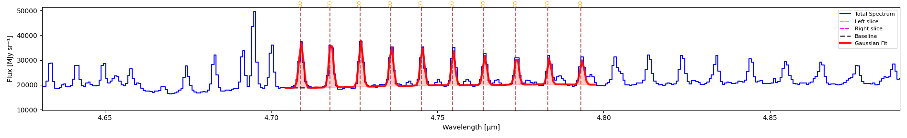

==================
CO Flux Extraction
==================

Extract and measure carbon monoxide (CO) line fluxes from spectral data cubes. This specialized tool analyzes CO emission or absorption across multiple rotational transitions.

Starting CO Flux Extraction
===========================

**Access Tool**

1. Click **HITRAN** menu in toolbar
2. Input min/max wavelengths and click on **HITRAN** button
3. Choose molecule, isotopologue number, and vibrational level
4. (Optionally) Refresh HITRAN query

The spectrum now shows the lines given those parameters.
Hovering over a line shows its species, its wavelength, its transition, and its Einstein coefficients
You can remove a line by clicking on it in the spectrum or by clicking on the **SPECIES** button which renders a table with all the current species.

Load Contaminating Lines
========================

Additionally (and optionally), you can load contaminating lines to automatically remove unwanted lines.

1. Click on **Load Contaminating Lines** and load a .csv file with unwanted lines

IMPORTANT: Make sure this file has a column called 'wavelength'.

Multi-Gaussian Fit
=====================

Fit each currently-plotted HITRAN line independently on the 1D spectrum — one Gaussian
per line, using the same fitter as :doc:`gaussian_fitting_1d`. ``fit_hitran_lines()`` in
``cube_explorer.api`` runs this exact algorithm (see *Using the API* below); it is not an
approximation of the GUI button, the two share the same code path.

1. Perform automatic continuum on the 1D spectrum by clicking on **Continuum Tools → Automatic Continuum → Continuum Line**
2. Click on **Multi-Gaussian Fit**

A Gaussian curve is overlaid on the spectrum for each plotted line, and a results window
opens with one block per line.

   Ten CO v=1→0 P-branch lines (J=5→14, 4.70–4.80 µm) fitted simultaneously via
   **Multi-Gaussian Fit** on a NIRSpec G395H spectrum.

Reading the results
--------------------

Each line's block reports two groups of numbers:

- **Catalog identification** — ``Line λ``, ``Transition``, ``A coeff`` and ``E_upper``,
  copied straight from the HITRAN entry, not measured. Useful for cross-checking that the
  fit actually locked onto the line you think it did.
- **Fitted parameters** — ``Center``, ``Amplitude``, ``Sigma``, ``FWHM``, ``Integrated
  Area`` and ``R²``, exactly as on the single-line results window (see
  :doc:`gaussian_fitting_1d` for what each one means). Units follow the same rules as the
  1D page — ``Integrated Area`` is erg/s/cm² wherever the header supports the conversion.

Using the API
--------------

.. code-block:: python

    from cube_explorer.api import load_cube, fit_hitran_lines

    cube = load_cube("data.fits")

    results = fit_hitran_lines(
        wavelength=cube.wavelength,
        spectrum=cube.spectrum,
        molecule='CO',
        wavelength_min=4.70,
        wavelength_max=4.80,
        v_upper=1,             # v=1->0 P-branch, same filter as the HITRAN dialog
        v_lower=0,
        header=cube.header,    # Required for the erg/s/cm2 conversion
        wave_unit=cube.wave_unit,
    )

    detected = [r for r in results if r['success']]
    print(f"Fitted {len(detected)}/{len(results)} lines")
    for r in sorted(detected, key=lambda r: r['wavelength']):
        print(f"  {r['wavelength']:.6f} um  area={r['area']:.4e} {r['area_unit']}  R2={r['r_squared']:.4f}")

This reproduces the worked example above exactly: fitted centers, areas and R² match the
screenshot's results window to the last reported digit, because it is the same fit.

.. important::

   As with ``fit_line``, pass ``header``/``wave_unit`` to get ``area`` in erg/s/cm² —
   without them it stays in the cube's native units, and ``area_unit`` always tells you
   which one you got. There is no continuum-fitting step in the example above because
   none was given: leaving ``continuum`` unset fits one automatically with
   ``fit_continuum()``, the same fallback the GUI uses when you have not run **Automatic
   Continuum** interactively. Pass your own ``continuum`` array to use a continuum you
   already fitted instead.

**Analyze CO for All Pixels**

Extract CO flux maps for each pixel:

1. Complete Automatic Continuum
2. Click on **CO Flux Map**

**Progress Monitoring**

- Progress bar shows % complete

**Output Products**

Resulting maps:

- **CO Flux Map**: Map with integrated flux for each pixel
- **Detection Count**: Map with count for each pixel

Using the CO Flux API
======================

Extract CO fluxes programmatically for single spectra or full data cubes, using
``extract_co_flux()`` and ``create_co_flux_map()`` -- the same algorithm as the GUI's
**CO Flux Map** button.

.. note::

   This is a **different algorithm** from **Multi-Gaussian Fit** / ``fit_hitran_lines()``
   above, not a scripted version of it. ``extract_co_flux``/``create_co_flux_map`` fit all
   lines in a wavelength chunk *simultaneously* against one shared continuum (via
   ``co_flux_extractor.py``), rather than one Gaussian per line independently. The two do
   not produce identical numbers for the same spectrum.

**Extract CO Flux from a Single Spectrum**

.. code-block:: python

    from cube_explorer.api import load_cube, extract_co_flux

    cube = load_cube("data.fits")

    co_result = extract_co_flux(
        wavelength=cube.wavelength,
        spectrum=cube.spectrum,
        co_catalog_path="path/to/CO_catalog.ecsv",
        header=cube.header,      # Required for the erg/s/cm2 conversion
        wave_unit=cube.wave_unit,
    )

    print(f"Total CO flux: {co_result['co_flux']:.4e} {co_result['flux_unit']}")
    print(f"Number of lines detected: {len(co_result['detected_lines'])}")
    print(f"Mean continuum level: {co_result['mean_continuum']:.3f}")

.. important::

   As with ``fit_line``/``fit_hitran_lines``, pass ``header``/``wave_unit`` to get
   ``co_flux``/``contam_flux`` in erg/s/cm2 -- without them they stay in the cube's native
   units, and ``flux_unit`` always tells you which one you got. Continuum subtraction runs
   automatically (``subtract_continuum=True`` by default, same defaults as the GUI's
   Automatic Continuum) -- there's no need to pre-subtract it yourself. Pass your own
   ``continuum_params`` dict to override those defaults, e.g.
   ``continuum_params={'window_size': 101}``.

**Create CO Flux Maps**

Generate flux maps for the entire data cube:

.. code-block:: python

    from cube_explorer.api import load_cube, create_co_flux_map

    cube = load_cube("data.fits")

    # Uses HITRAN automatically by default, or pass co_catalog_path for a custom catalog
    co_flux_map = create_co_flux_map(
        cube,
        wavelength_min=4.70, wavelength_max=4.80,
        n_jobs=4,
    )

    print(f"CO flux map shape: {co_flux_map['flux_map'].shape}, unit: {co_flux_map['flux_unit']}")
    print(f"Mean CO flux: {co_flux_map['flux_map'][co_flux_map['flux_map'] > 0].mean():.4e}")
    print(f"Pixels with CO detection: {(co_flux_map['detection_map'] > 0).sum()}")

Continuum subtraction works the same way as ``extract_co_flux`` above -- automatic per
pixel, with the default parameters unless you pass your own via ``continuum_params``. There's
no separate ``header`` argument here since ``cube`` (and its header) is already the first
argument; the erg/s/cm2 conversion is attempted automatically, and ``flux_unit`` tells you
whether it succeeded.

**Expected Catalog Format**

The CO catalog file should be in ECSV (Enhanced Character Separated Values) format with columns:

- ``line_wave_um``: Wavelength in micrometers
- ``species``: Molecule name (e.g., "CO")
- ``transition``: Transition description (e.g., "v=1->0, J=4->5")
- ``a``: Einstein A coefficient

Columns are loaded as-is, with no validation -- a file missing ``line_wave_um`` or
``species`` won't fail at load time, only later inside the fit, as a ``KeyError``.

**Tips for CO Flux Extraction**

- Ensure your wavelength calibration is accurate (errors affect line identification)
- The algorithm automatically measures line widths and integrates flux
- For more control over individual line fits, use ``fit_hitran_lines()`` instead
