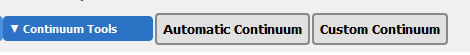
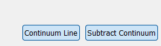
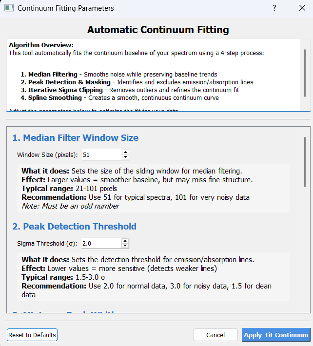
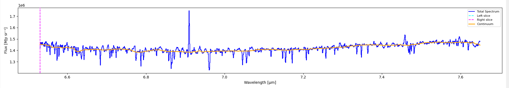
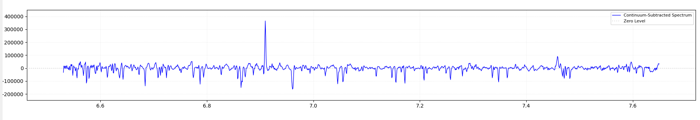
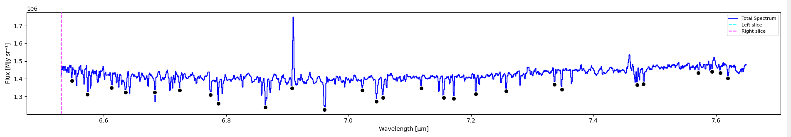
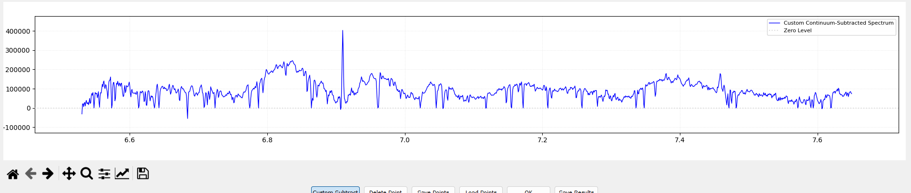
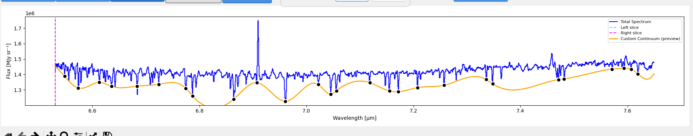

=====================
Continuum Subtraction
=====================

A "continuum" is the smoothly-varying baseline that underlies the
emission and absorption features in your spectrum. Most line-fitting and
flux-extraction workflows assume the continuum has been removed first.

IFU Analyzer provides two complementary tools for continuum subtraction:

- **Automatic Continuum** — a 4-step algorithm that fits a baseline
  without any clicks: median filter → peak detection → iterative sigma
  clipping → spline smoothing.
- **Custom Continuum** — manual point-and-click placement of anchor
  points that are then connected with a cubic spline. Use this when the
  spectrum has unusual shape (broad features, instrumental artefacts,
  step changes) that defeat the automatic fitter.

You can switch between modes at any time, but only one is "active" at
once. A confirmation dialog appears if you switch while progress exists
in the other mode, so you don't lose work by accident.

.. contents::
   :local:
   :depth: 2

When to use which mode
======================

============================================  ======================================================
Spectrum characteristic                       Best mode
============================================  ======================================================
Smooth, monotonic continuum, narrow lines     **Automatic** (default parameters usually work)
Many lines, but baseline still smooth         Automatic with looser peak detection (sigma ≈ 1.5)
Broad emission with shallow wings             Automatic with larger ``peak_exclusion``
Strong instrumental artefacts (steps, dips)   **Custom** — automatic can't model discontinuities
Sparse, well-isolated line-free regions       **Custom** — fastest, places ~5 anchor points
Unusual baseline shape (curved, wavy)         **Custom** — fit only where you have signal-free data
============================================  ======================================================

Automatic Continuum
===================

Activating the mode
-------------------

Click the **Automatic Continuum** toggle button in the GUI's continuum
panel. Two additional buttons appear underneath:

- **Continuum Line** — fits the continuum and overlays it (in orange)
  over the original spectrum, without changing the data.
- **Subtract Continuum** — applies the fitted continuum, replacing the
  displayed spectrum with the continuum-subtracted version.

The split into two steps is intentional: you fit and *preview*, then
decide whether to apply.

Fitting the continuum
---------------------

Click **Continuum Line**. The Continuum Parameters dialog opens with
seven tunable parameters and an algorithm overview:

.. list-table::
   :widths: 22 14 64
   :header-rows: 1

   * - Parameter
     - Default
     - What it does
   * - Median Filter Window Size
     - 51 pixels
     - Sliding window for the first-pass continuum estimate. Larger →
       smoother baseline, but may miss fine structure. Must be odd.
   * - Peak Detection Threshold (σ)
     - 2.0
     - Detection cutoff for emission/absorption lines. Lower → more
       sensitive; use 1.5 for very clean data, 3.0 for noisy data.
   * - Minimum Peak Width
     - 1 pixel
     - Minimum width for a feature to count as a peak. Filters out noise
       spikes and very narrow artefacts.
   * - Minimum Peak Separation
     - 3 pixels
     - Minimum distance between detected peaks. Prevents the algorithm
       from finding multiple peaks in the same feature.
   * - Peak Exclusion Zone
     - 3 pixels
     - Number of pixels on each side of a detected peak that are masked
       before the final fit. Use larger values for broad lines.
   * - Outlier Removal Iterations
     - 2
     - How many sigma-clipping passes to run after the first fit. More
       iterations → cleaner baseline but slower.
   * - Spline Smoothing Factor
     - 5
     - Controls how smooth the final spline is. Lower → closer to the
       data; higher → smoother curve. ``s = N / smoothing_factor`` where
       ``N`` is the number of data points.

Click **Reset to Defaults** at any point to restore all seven values.
Click **Apply & Fit Continuum** to run the algorithm. The fitted curve
appears in orange over the original spectrum:

If you don't like the fit, click **Continuum Line** again to reopen the
dialog with your last parameters and try different settings.

Applying the subtraction
------------------------

Once you're happy with the preview, click **Subtract Continuum**. The
displayed spectrum is replaced with the continuum-subtracted version
(orange curve subtracted from the original). The y-axis rescales
automatically so the now-near-zero baseline is visible alongside the
line peaks.

A guard prevents double-subtraction: if you click Subtract Continuum
twice in the same session, the second click is ignored — there's nothing
to subtract.

Behind the scenes
-----------------

The algorithm runs in 4 steps:

1. **Median filter** of width ``window_size`` produces a first-pass
   continuum estimate.
2. **Peak detection** using ``scipy.signal.find_peaks`` finds features
   above ``sigma_threshold × RMS`` with the given width and distance
   constraints.
3. **Peak masking** sets a region of width ``peak_exclusion`` around
   every detected peak to be ignored, then the median filter is
   re-applied to the masked data.
4. **Iterative sigma clipping** (``iterations`` passes) removes
   outliers above the running continuum estimate.
5. **Spline smoothing** fits a ``UnivariateSpline`` (k=3) with smoothing
   parameter ``s = N / smoothing_factor`` to the cleaned continuum.

The result is stored as a 1D array the same length as the wavelength
axis and overlaid in orange before subtraction.

Custom Continuum
================

Activating the mode
-------------------

Click the **Custom Continuum** toggle. Five additional buttons appear:

- **Custom Subtract** — enter point-placement mode.
- **Delete Point** — toggle delete mode (click points to remove them).
- **Save Points** — export the current anchor points to a CSV file.
- **Load Points** — re-import previously-saved anchor points.
- **OK** — fit the spline and preview the result.

The unified **Save Results** button (shared with Automatic mode) writes
the full subtraction result to disk and is available as soon as a
continuum has been fitted in either mode.

Switching to Custom while Automatic progress exists prompts a
confirmation dialog. Confirming clears the automatic state — you start
fresh.

Placing anchor points
---------------------

1. Click **Custom Subtract** to enter placement mode.
2. Click directly on the spectrum at line-free regions where you want
   the continuum to pass through. Each click adds a point; the point
   snaps to the nearest data value so it sits exactly on the curve.
3. Aim for at least **3 points** (mathematical minimum for a cubic
   spline). For most spectra, 5–10 well-spread points produce excellent
   fits.

Editing the points
------------------

- **Move a point** — click and drag a placed point.
- **Delete a single point** — click **Delete Point** (it toggles on)
  then click the point you want to remove. Click Delete Point again to
  exit delete mode.
- **Clear all** — switch to **Automatic Continuum** and back; the
  confirmation dialog gives you the option to clear progress.

Saving and loading point sets
-----------------------------

Reusable point sets are saved as a simple CSV. This is handy when you
have many similar cubes and want to apply the same continuum strategy
to all of them.

**Save Points** prompts for a filename and writes:

.. code-block:: text

   # Wavelength, Flux
   3.0000e-06, 1.2345e-02
   3.5000e-06, 1.2378e-02
   4.0000e-06, 1.2412e-02

**Load Points** reads the same format. Lines starting with ``#`` and
blank lines are ignored. Loading replaces the current point set; it
doesn't append.

Previewing and confirming
-------------------------

Click **OK** when you've placed all the points you want. The fitter:

1. Sorts the points by wavelength.
2. Fits a cubic spline with ``bc_type='natural'`` (no enforced slope at
   endpoints).
3. Evaluates the spline at every wavelength channel.
4. Displays the result in orange over the original spectrum.
5. Opens a confirmation dialog: **"The fitted continuum is shown in
   orange. Subtract it from the spectrum?"**

Clicking **Yes** subtracts the fitted curve and replaces the displayed
spectrum. Clicking **No** keeps the orange preview but doesn't subtract
— you can keep tweaking points and click OK again.

After subtraction, the spectrum y-axis rescales so the subtracted curve
is visible. The **Save Results** button becomes the recommended way to
export everything (see :ref:`saving-the-fitted-continuum` below).

.. _saving-the-fitted-continuum:

Saving the results
==================

A single **Save Results** button writes everything you need to disk:
the original spectrum, the fitted continuum, and the
continuum-subtracted spectrum, all in one tab-delimited ASCII file.

Output format
-------------

.. code-block:: text

   # Results Export from Cube Explorer
   # Instrument: MIRI
   # Type: full_results
   # Wavelength unit: micron
   # Flux unit: MJy/sr
   #
   # Wavelength (micron)   Original         Continuum        Subtracted
   6.530400e+00            1.420169e+06     1.450957e+06     -3.078756e+04
   6.531200e+00            1.468611e+06     1.448846e+06      1.976483e+04
   ...

Four columns:

- **Wavelength** — in the unit reported by the FITS header.
- **Original** — the spectrum before any subtraction was applied.
- **Continuum** — the fitted continuum (smooth baseline). ``NaN`` if no
  continuum has been fitted yet.
- **Subtracted** — ``Original − Continuum``. ``NaN`` if no continuum
  has been fitted.

The ``Subtracted`` column always equals ``Original − Continuum`` to
machine precision. This is true whether or not you actually clicked the
Subtract button — the file always lets you reconstruct both the original
and the subtracted spectrum.

When the button is available
----------------------------

- **No continuum fitted yet** — the button is still active; the file
  will contain wavelength and the original spectrum, with the continuum
  and subtracted columns filled with ``NaN``.
- **Continuum fitted but not yet subtracted** — all four columns are
  populated; the subtracted column is computed without you having to
  click Subtract.
- **Continuum fitted and subtracted** — same four columns; the file is
  identical regardless of subtraction state.

This means the saved file is **always reproducible**: the same
continuum and the same original spectrum give the same four columns,
no matter when in the workflow you press the button.

Reusing the continuum from the command line
-------------------------------------------

The saved continuum is compatible with the CLI's ``subtract-continuum``
tool, but the CLI expects a file with header ``# Type:
fitted_continuum``. To reuse a continuum exported by the GUI, you have
two options:

1. **Extract the continuum column.** Open the results file in your
   favourite tool, drop the Original and Subtracted columns, change the
   header line to ``# Type: fitted_continuum``, and save.
2. **Use the CLI's own auto-continuum.** For batch processing of many
   cubes, it's usually faster to run ``clip.py auto-continuum`` once
   per cube and pipe its output into ``subtract-continuum``. See
   :doc:`../cli` for the workflow.

Recovery and resets
===================

The continuum panel tracks two independent kinds of state:

- **Automatic progress** — whether a fit exists, whether the preview is
  shown, whether subtraction has been applied.
- **Custom progress** — whether the placement session is active,
  whether points exist, whether subtraction has been applied.

If you toggle between modes, the active mode's progress is preserved
and the *other* mode's progress is cleared (after a confirmation
dialog). This means:

- You can switch from Automatic to Custom without losing your
  automatic fit until you confirm the clear.
- After a subtraction has been applied, the original spectrum is backed
  up internally. Subsequent operations re-fit against the backup, not
  the already-subtracted spectrum, so you can iterate safely.

Common issues
=============

The fit looks high (overshoots into line peaks)
-----------------------------------------------

Increase **Peak Detection Threshold** (try ``sigma = 1.5``) so more
peaks are detected and masked. Or increase **Peak Exclusion Zone** so
the wings of broad lines are also excluded from the fit.

The fit looks low (cuts into the continuum between lines)
---------------------------------------------------------

Decrease **Spline Smoothing Factor** to let the fit follow the data
more closely. Or decrease **Outlier Removal Iterations** to 1.

The fit has wiggles where the data is featureless
-------------------------------------------------

Increase **Spline Smoothing Factor** (try ``10`` or ``20``) for a
smoother spline. Or increase **Median Filter Window Size** to ``101``.

The Subtract Continuum button is disabled
-----------------------------------------

Click **Continuum Line** first to compute a fit. Subtract is enabled
only after a continuum has been fitted.

Custom subtract complains "Place at least 3 points"
---------------------------------------------------

A cubic spline needs at least 3 anchor points. Click on three or more
line-free regions of the spectrum.

I want to revert to the original spectrum
-----------------------------------------

Toggle the active mode off, then on again. The continuum panel
automatically restores the backup of the original spectrum when you
start a new session.

See also
========

- :doc:`gaussian_fitting` — the next step after continuum subtraction
  for most workflows.
- :doc:`../cli` — ``auto-continuum``, ``custom-continuum``, and
  ``subtract-continuum`` command-line equivalents for batch processing.
- :doc:`exporting_data` — full reference for all spectrum/continuum
  export formats.
