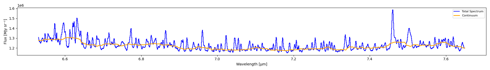
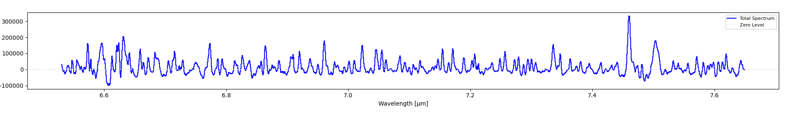

=======================
Continuum Subtraction
=======================

The continuum is the underlying stellar/background emission that spans the entire spectrum
(as opposed to narrow spectral lines which are superimposed on top). Removing the continuum
is essential for accurate line flux measurements.

Automatic Continuum Subtraction
================================

IFU Analyzer includes an automatic continuum fitting algorithm that:

1. Detects emission/absorption peaks (spectral lines) in the spectrum
2. Fits a smooth curve through the remaining "line-free" pixels
3. Subtracts this fitted continuum from the spectrum

**Via the GUI:**

1. Click **Continuum Tools** in the toolbar
2. Click **Automatic Continuum**. Two buttons appear in a row under the toolbar:
   **Fit Continuum** and **Subtract Continuum**
3. Click **Fit Continuum**. The "Continuum Fitting Parameters" window opens. It has seven
   settings: Window Size (pixels), Sigma Threshold (σ), Minimum Peak Width, Minimum Peak
   Separation, Peak Exclusion Zone, Number of Iterations, and Smoothing Factor. Accept the
   defaults or change them, then click OK. The fitted continuum shows on the spectrum
4. Click **Subtract Continuum**. The spectrum updates to show the continuum-subtracted result
5. Click **Subtract Continuum** again to undo the subtraction. Click **Fit Continuum** again
   to remove the continuum line

The continuum is fitted and subtracted for the tab that is active (Full, Left Region, or
Right Region). Each tab keeps its own continuum.

If you click **Subtract Continuum** before a continuum exists, the message "Click Fit
Continuum first." appears. If you switch between Automatic and Custom mode, the application
asks you to confirm, because it clears the progress of the other mode.

   The fitted continuum (orange) overlaid on the total spectrum (blue) before subtraction.

   The same spectrum after subtraction -- lines now sit on a flat, near-zero baseline
   instead of the sloped/varying continuum above.

Custom Continuum Subtraction
============================

Use the custom mode when the automatic fit does not follow your continuum. You choose the
points, and the application fits a cubic spline through them.

**Via the GUI:**

1. Click **Continuum Tools**, then **Custom Continuum**. A row of buttons appears:
   **Custom Subtract**, **Delete Point**, **Save Points**, **Load Points**, and **OK**
2. Click **Custom Subtract**. A window with instructions opens
3. Click on the spectrum to add continuum points. Each point snaps to the nearest data
   point. Choose places **without** emission or absorption lines. You need at least **3**
   points, and more points give a better fit
4. To remove a point, right-click its black marker. Or turn on **Delete Point** and
   left-click the marker
5. Click **OK** (or press ENTER) when you are done. The fitted continuum shows in orange, and
   the application asks "Subtract it from the spectrum?". Click Yes to subtract. Press ESC to cancel
6. Click **Custom Subtract** again to undo the subtraction

If the keys do not work, click on the spectrum plot first.

**Save Points** writes the points to a text or CSV file (wavelength and flux). **Load Points**
reads such a file into the current session. Use them to reuse the same points on another cube.

Save Continuum Cubes
====================

**Save Continuum Cubes** (in the **Continuum Tools** group) fits the continuum at **every
pixel** and writes two cubes. The two cubes always add up to the original cube.

1. Click **Save Continuum Cubes**
2. Choose the method:

   - **Automatic**: the application asks for the same seven settings as above
   - **Custom**: you place the points on the spectrum, as in the custom mode, and press OK.
     Only the wavelengths of the points are used. Each pixel gets a cubic spline through its
     own flux at those wavelengths

3. Choose a base file name. The application writes ``<name>_continuum.fits`` (the continuum
   cube) and ``<name>_contsub.fits`` (the continuum-subtracted cube). If the files exist,
   it asks before it overwrites them
4. A progress window shows the fit. **Cancel** stops it

Pixels that have data but get no continuum are NaN in both cubes. The completion message
tells you how many.

**Using the Continuum API**

Fit and subtract continuum programmatically:

.. code-block:: python

    from cube_explorer.api import load_cube, fit_continuum
    
    # Load data
    cube = load_cube("data.fits")
    spectrum = cube.spectrum
    wavelength = cube.wavelength
    
    # Fit continuum using automatic peak detection
    continuum = fit_continuum(
        wavelength,
        spectrum,
        sigma_threshold=2.0,      # Peak detection sensitivity
        peak_exclusion=3,         # Pixels to exclude near peaks
        iterations=2              # Iterative refinement
    )
    
    # Subtract to get line-only spectrum
    line_spectrum = spectrum - continuum
    
    print(f"Original spectrum range: {spectrum.min():.3f} to {spectrum.max():.3f}")
    print(f"Line-only spectrum range: {line_spectrum.min():.3f} to {line_spectrum.max():.3f}")

**Continuum Parameters**

You can fine-tune the continuum fitting with these parameters:

.. code-block:: python

    continuum = fit_continuum(
        wavelength,
        spectrum,
        window_size=51,           # Window for median filter (must be odd)
        sigma_threshold=2.0,      # Prominence threshold in sigma
        peak_width=1,             # Minimum width of a peak, in pixels
        peak_distance=3,          # Minimum pixels between peaks
        peak_exclusion=3,         # Pixels excluded on each side of peak
        iterations=2,             # Number of refinement iterations
        smoothing_factor=5        # Spline smoothing parameter
    )

Higher ``sigma_threshold`` values are less aggressive (detect fewer lines).
Lower ``sigma_threshold`` values are more aggressive (detect more lines).

**Saving continuum cubes**

``save_continuum_cubes`` does the same as the **Save Continuum Cubes** button. It needs an
``if __name__ == "__main__":`` guard on Windows and macOS, because it uses several processes:

.. code-block:: python

    from cube_explorer.api import load_cube, save_continuum_cubes

    if __name__ == "__main__":
        cube = load_cube("data.fits")

        # Automatic method (default parameters, or pass continuum_params={...})
        n_failed = save_continuum_cubes(cube, "cube_continuum.fits", "cube_contsub.fits")

        # Custom method: the wavelengths of the points that you would click in the GUI
        n_failed = save_continuum_cubes(
            cube, "cube_continuum.fits", "cube_contsub.fits",
            anchor_wavelengths=[6.55, 6.70, 6.95, 7.20, 7.35])

The function returns the number of pixels that have data but got no continuum.

**Tips for Better Continuum Fits**

- If too much continuum is being subtracted, increase ``sigma_threshold``
- If not enough continuum is being subtracted, decrease ``sigma_threshold``
- For noisy data, increase ``iterations`` for more refinement
- Adjust ``window_size`` based on the width of spectral features (wider features = larger window)
