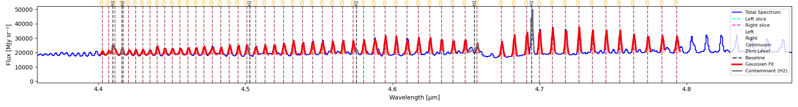
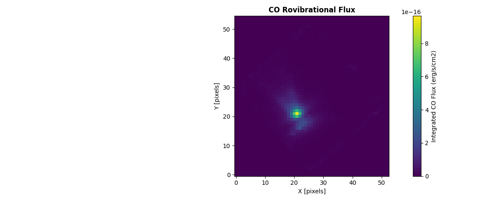
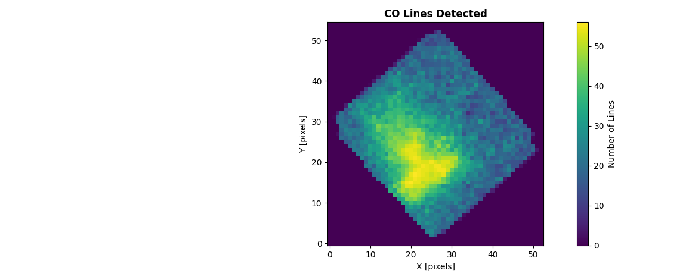
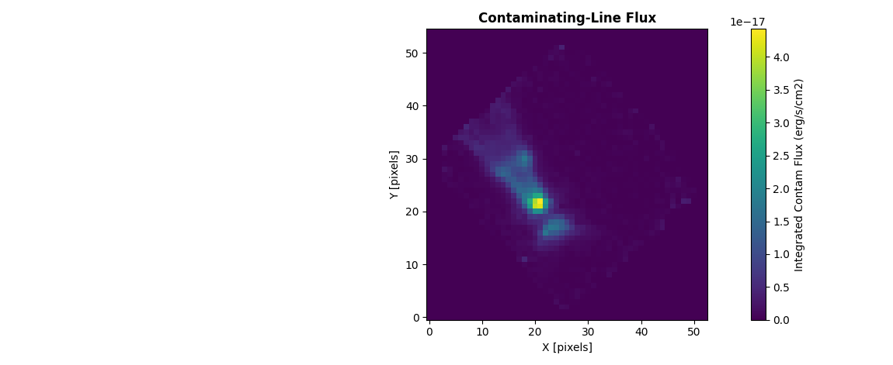
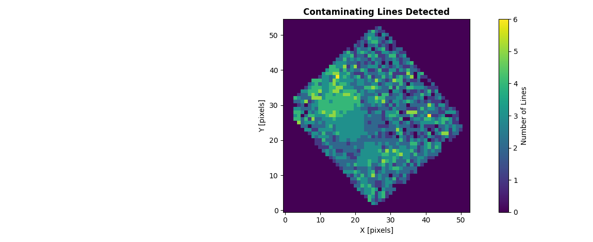
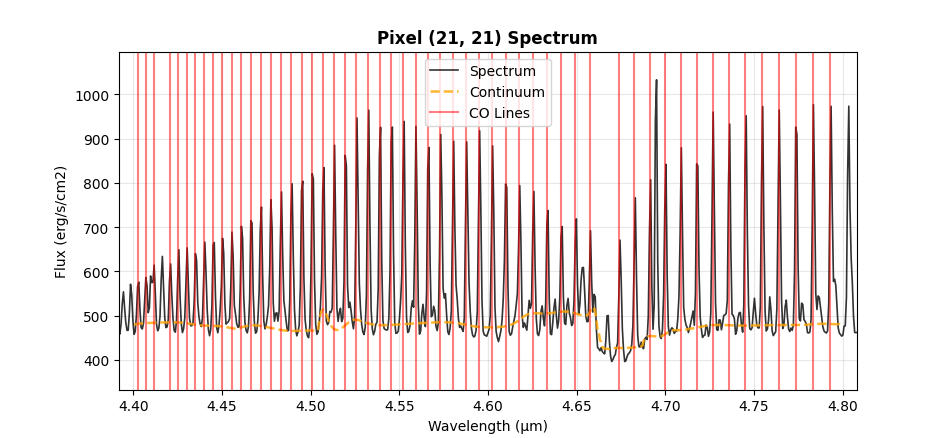

================
Flux Extraction
================

Extract and measure spectral line fluxes for a chosen target species (CO, H2, or any
molecule/atom HITRAN or a custom catalog supports) from spectral data cubes. This tool
analyzes emission or absorption across multiple rotational transitions of that species.

Starting Flux Extraction
=========================

**Fetch from HITRAN**

1. Enter min/max wavelengths in the toolbar, then click **HITRAN**
2. Choose a molecule (required)
3. Choose isotopologue number (optional)
4. Choose transition level (optional, different molecules have different transition levels)
5. Refresh HITRAN cache (optional)

**Import Lines**

When HITRAN isn't reachable, click **Import Lines** to load your own line list from a CSV
instead. Both ``wavelength`` and ``species`` columns are required.

Once lines are loaded (either way), the spectrum shows them. Hovering over a line shows its
species, wavelength, transition, and Einstein coefficients. Click **Lines** to open a table
of every currently loaded line: detections and contaminants together, with "Detection
Only"/"Contaminating Only" filters. Check/uncheck rows to change what's plotted.

Load Contaminating Lines
=========================

Additionally (and optionally), you can load a catalog of contaminating (non-target) lines
so both **Flux Map** and **Multi-Gaussian Fit** (below) can account for them instead of
letting their flux distort a nearby target line's measurement.

1. Click **Contam. Lines** and load a CSV file with unwanted lines

Both ``wavelength`` and ``species`` columns are required.

Run **Flux Map** / **Multi-Gaussian Fit** again after loading it for the fit to pick it up.

Multi-Gaussian Fit
=====================

Fit every currently-plotted line at once via ``curve_fit``, using each line's own
instrumental width. Lines that land in the same wavelength chunk (close or blended) are fit
together against one shared continuum, so they no longer double-claim overlapping flux the
way independent, uninformed per-line fits would.

Each line's starting width comes from the instrument's own spectral resolution, but center
and sigma are **fitted, not fixed** because each is constrained to a bounded range around
that starting point (center within ±1 instrumental σ of the catalog wavelength, sigma within
0.5–2× the instrumental value), so a real line can settle slightly off its catalog center or
resolve a little narrower/wider than nominal.

If you've loaded a contaminating-lines catalog (above), any contaminant sharing a
wavelength chunk with a requested line gets its own Gaussian component too, so its flux is
absorbed there instead of leaking into that line's amplitude. It's drawn in **grey** on the
plot and listed separately in the results. It's never counted toward the target line total or
"Total Integrated Flux", but summed on its own as "Total Contaminant Flux" (see *Reading
the results* below).

1. (Optional) Fit a continuum first via **Continuum Tools → Automatic Continuum → Continuum
   Line**. If you skip this, **Multi-Gaussian Fit** computes one automatically the first
   time you click it.
2. Click **Multi-Gaussian Fit**

A Gaussian curve is overlaid on the spectrum for each plotted line, and a results window
opens with one block per line, an overall summary, and a separate section listing any
contaminating lines that got their own component. Re-running with the same lines,
contaminants, and active tab offers the cached results instead of re-fitting.

   56 CO v=1→0 lines (4.40–4.80 µm) fitted simultaneously via **Multi-Gaussian Fit** on a
   NIRSpec G395H spectrum -- CO used here as the worked example; any target species works
   the same way. The grey curves are H2 lines from the loaded contaminating-lines catalog,
   each fit as its own component. The tallest, near 4.69 µm, would otherwise have distorted
   its neighboring CO lines' amplitudes.

Reading the results
--------------------

Each line's block reports two groups of numbers:

- **Catalog identification** — ``Line λ``, ``Transition``, ``A coeff`` and ``E_upper``,
  copied straight from the HITRAN entry, not measured. Useful for cross-checking that the
  fit actually locked onto the line you think it did.
- **Fitted parameters** — ``Center``, ``Amplitude``, ``Sigma``, ``FWHM``, ``Integrated
  Area`` and ``R²``. ``Center`` and ``Sigma`` are fitted, not fixed, but each is bounded
  around the catalog wavelength and the instrument's spectral resolution respectively (see
  above). Units follow the same rules as the 1D page (:doc:`gaussian_fitting_1d`):
  ``Integrated Area`` is erg/s/cm² wherever the header supports the conversion.

An **OVERALL** summary follows every line block, e.g. from a real 56-line CO run:

.. code-block:: text

    OVERALL:
      Total lines fitted:    56
      Total Integrated Flux: 2.7085e-14 erg/s/cm²
      Mean R²:               0.9768
      Lines with R² >= 0.5:  56/56
      Total Contaminant Flux: 2.3774e-15 erg/s/cm²

``Total Contaminant Flux`` only appears when a contaminating-lines catalog is loaded, and is
summed separately from ``Total Integrated Flux`` (contaminants are never considered for the
target total).

A **CONTAMINATING LINES** section follows whenever any contaminant got its own component:
wavelength, species, amplitude and area for each (not part of the target line count or
totals above). From the same run:

.. code-block:: text

    CONTAMINATING LINES (not part of the 56 lines above -- shown in grey on the plot):
    ======================================================================
    1. H2 @ 4.410011 µm  amplitude=6.3049e+03 MJy sr⁻¹  area=2.9563e-16 erg/s/cm²
    2. H2 @ 4.416644 µm  amplitude=4.0638e+03 MJy sr⁻¹  area=2.3147e-16 erg/s/cm²
    3. H2 @ 4.502312 µm  amplitude=1.4162e-03 MJy sr⁻¹  area=4.3696e-23 erg/s/cm²
    4. H2 @ 4.575760 µm  amplitude=2.8655e+03 MJy sr⁻¹  area=9.2912e-17 erg/s/cm²
    5. H2 @ 4.655038 µm  amplitude=1.7061e+03 MJy sr⁻¹  area=2.0365e-16 erg/s/cm²
    6. H2 @ 4.694877 µm  amplitude=3.3151e+04 MJy sr⁻¹  area=1.5537e-15 erg/s/cm²

Using the API
--------------

.. code-block:: python

    from cube_explorer.api import load_cube, fit_hitran_lines
    from cube_explorer.line_catalog import load_contaminating_lines_catalog

    cube = load_cube("data.fits")
    contam = load_contaminating_lines_catalog("path/to/ContaminatingLines.csv")  # optional

    results = fit_hitran_lines(
        wavelength=cube.wavelength,
        spectrum=cube.spectrum,
        molecule='CO',
        wavelength_min=4.40,
        wavelength_max=4.80,
        v_upper=1,              # v=1->0, same filter as the HITRAN dialog
        v_lower=0,
        header=cube.header,     # Required for the erg/s/cm2 conversion
        wave_unit=cube.wave_unit,
        contam_catalog=contam,  # omit (or None) to skip contaminant handling entirely
    )

    detected = [r for r in results if r['success']]
    print(f"Fitted {len(detected)}/{len(results)} lines")
    for r in sorted(detected, key=lambda r: r['wavelength']):
        print(f"  {r['wavelength']:.6f} um  area={r['area']:.4e} {r['area_unit']}  R2={r['r_squared']:.4f}")

.. code-block:: text

    Fitted 56/56 lines
      4.402940 um  area=1.7523e-16 erg/s/cm²  R2=0.9522
      4.407340 um  area=2.0514e-16 erg/s/cm²  R2=0.9760
      4.411409 um  area=3.2444e-16 erg/s/cm²  R2=0.9919
      ...
      4.773897 um  area=5.4440e-16 erg/s/cm²  R2=0.9945
      4.783681 um  area=5.0950e-16 erg/s/cm²  R2=0.9889
      4.793562 um  area=5.5141e-16 erg/s/cm²  R2=0.9156

**Run the Full-Cube Flux Map**

Extract a flux map across every spatial pixel, for whichever lines are currently checked
in the **Lines** dialog (any species -- the map isn't restricted to CO):

1. Click on **Flux Map**.
2. A popup explains that continuum subtraction runs automatically per pixel, using default
   parameters that work well for typical spectra. Click **No** to use those defaults, or
   **Yes** to open the same parameter dialog as the manual Automatic Continuum tool and set
   your own values instead.
3. A preview shows the brightest pixel within your wavelength range (a sanity check before
   committing to a full-cube run), and exactly the checked lines that will be fit. Click
   **YES - Extract Map** to proceed.

If you've already run an extraction with the same wavelength range, line selection, and
continuum choice, you'll be offered the cached results instead of re-running.

**Progress Monitoring**

The progress dialog updates per pixel as the cube is processed.

**Output Products**

The **Display** dropdown in the results window switches between four maps, all from the
same run. The flux/detection labels reflect whichever species was targeted (e.g. "CO Flux"
for a CO run, "H2 Flux" for H2) -- the example below used CO:

   **CO Flux**: integrated flux per pixel, for a run targeting CO.

   **Detection Count**: number of target lines detected per pixel, for the same cube.

   **Contam Flux**: integrated contaminating-line flux per pixel, computed as part of the
   same per-pixel fit and summed separately from the target flux (never mixed into the
   target total).

   **Contam Detection Count**: number of contaminating lines detected per pixel.

**Export as FITS** / **Show Statistics** buttons in the results window apply to whichever
map is currently selected.

**Inspecting Individual Pixels**

With **Pixel Select** on (the default), clicking a pixel on any of the four maps opens that pixel's fit:

   Spectrum for an individual pixel, zoomed to the run's fitted wavelength range (here the
   full 4.40–4.80 µm, 56-line CO band), with the real per-chunk fitted continuum trend and
   every detected target line marked in red.

Turn **Pixel Select** off to zoom/pan the map freely instead of reopening this dialog on every
click.

Using the Flux API
====================

Extract fluxes programmatically for single spectra or full data cubes, using
``extract_flux()`` and ``create_flux_map()``, the same algorithm as the GUI's
**Flux Map** button.

.. note::

   This is a **different algorithm** from **Multi-Gaussian Fit**, and the two don't produce
   identical totals for the same spectrum. Both now fit lines simultaneously via the same
   function, so the real remaining difference isn't the fitting method itself, it's *which*
   lines get fit: ``extract_flux``/``create_flux_map`` auto-detect lines per pixel and
   only count one that clears a signal-to-noise threshold first (``snr_threshold``, default
   3σ). ``fit_hitran_lines`` has no SNR gate at all: it fits whatever you selected, weak
   lines included. Summed over many pixels this adds up to Flux Map running
   systematically lower. Lowering ``snr_threshold`` would let more noise into the flux
   instead (a trade-off, not a fix).

**Extract Flux from a Single Spectrum**

.. code-block:: python

    from cube_explorer.api import load_cube, extract_flux

    cube = load_cube("data.fits")

    flux_result = extract_flux(
        wavelength=cube.wavelength,
        spectrum=cube.spectrum,
        target_catalog_path="path/to/CO_catalog.ecsv",
        header=cube.header,      # Required for the erg/s/cm2 conversion
        wave_unit=cube.wave_unit,
    )

    print(f"Total flux: {flux_result['flux']:.4e} {flux_result['flux_unit']}")
    print(f"Number of lines detected: {len(flux_result['detected_lines'])}")
    print(f"Mean continuum level: {flux_result['mean_continuum']:.3f}")

**Create Flux Maps**

Generate flux maps for the entire data cube:

.. code-block:: python

    from cube_explorer.api import load_cube, create_flux_map

    cube = load_cube("data.fits")

    # Uses HITRAN (CO by default) automatically, or pass target_catalog_path for a custom catalog
    flux_map_result = create_flux_map(
        cube,
        wavelength_min=4.70, wavelength_max=4.80,
        n_jobs=4,
    )

    print(f"Flux map shape: {flux_map_result['flux_map'].shape}, unit: {flux_map_result['flux_unit']}")
    print(f"Mean flux: {flux_map_result['flux_map'][flux_map_result['flux_map'] > 0].mean():.4e}")
    print(f"Pixels with a detection: {(flux_map_result['detection_map'] > 0).sum()}")
    print(f"Pixels with a contam detection: {(flux_map_result['contam_detection_map'] > 0).sum()}")
    print(f"Mean contam flux: {flux_map_result['contam_flux_map'][flux_map_result['contam_flux_map'] > 0].mean():.4e}")

Continuum subtraction works the same way as ``extract_flux`` above (automatic per
pixel, with the default parameters unless you pass your own via ``continuum_params``).

**Expected Catalog Format**

The target catalog file should be in ECSV (Enhanced Character Separated Values) format with columns:

- ``line_wave_um``: Wavelength in micrometers
- ``species``: Molecule name (e.g., "CO", "H2")
- ``transition``: Transition description (e.g., "v=1->0, J=4->5")
- ``a``: Einstein A coefficient

Columns are loaded as-is, with no validation: a file missing ``line_wave_um`` or
``species`` won't fail at load time, only later inside the fit, as a ``KeyError``.

**Tips for Flux Extraction**

- Ensure your wavelength calibration is accurate (errors affect line identification)
- The algorithm automatically measures line widths and integrates flux
- For more control over individual line fits, use ``fit_hitran_lines()`` instead

Next Steps
==========

- :doc:`gaussian_fitting_cube` — the general per-pixel Gaussian fitting this shares its
  algorithm with
- :doc:`exporting_data` — other export paths
- :doc:`2d_viewer` — open the exported target/contam flux maps with WCS support
