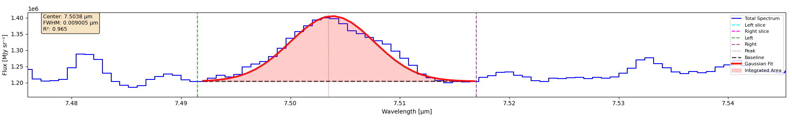

===================
1D Spectrum Fitting
===================

Fit a single Gaussian profile to one spectral line in the currently displayed 1D spectrum.

This is the fast, interactive fit: you pick a wavelength window by hand, get one set of
parameters back, and use it to understand your data before committing to a full-cube run.
For fitting every spatial pixel at once, see :doc:`gaussian_fitting_cube`.

Selecting the Fit Region
========================

Click **Gaussian Fit** on the middle toolbar to reveal the fitting controls. You then mark
three wavelengths on the spectrum:

- **Left** (λ_left): the shorter-wavelength edge of the fit window
- **Peak** (λ_peak): the approximate line center, used as the initial guess for the fit
- **Right** (λ_right): the longer-wavelength edge of the fit window

Each of **Left**, **Peak** and **Right** stays pressed until you click it again. The
workflow is:

1. Click the button for the point you want to set
2. Click on the spectrum at that wavelength
3. Click the button again to release it

The window between λ_left and λ_right is the only data the fit sees. λ_peak does not
constrain the result — it only seeds the optimizer, and the fitted center is bounded by
the window edges, not by your click.

.. note::

   **A rough click is fine.** Anywhere inside the window converges to the same answer.

.. _ordering-rules:

The three points must be in order — ``λ_left < λ_peak < λ_right``. Both rules are
enforced, and a violation stops the fit rather than producing a result you did not ask
for:

.. list-table::
   :header-rows: 1
   :widths: 40 60

   * - Selection
     - What happens
   * - Left at a longer wavelength than Right
     - *Error: Left boundary must be less than the right boundary. Re-select the
       boundaries in order.*
   * - Peak outside the Left–Right window
     - *Error: Peak lies outside the fit window. Move the Peak marker inside the
       Left/Right boundaries.*

Re-toggle the offending button and click again; the other two points are kept.

Running the Fit
===============

Click **Fit Gaussian**. A Gaussian curve overlay appears on the spectrum, and a results
window opens.

The fit is performed on baseline-subtracted data: a straight line is drawn between the
flux values at the two window edges and subtracted before the Gaussian is fitted, so a
sloping continuum does not bias the width or area.

   A completed fit, zoomed to the selected window. The green and purple dashed lines are
   the **Left** and **Right** boundaries; the red dotted line is the **Peak** click. The
   black dashed line is the linear **Baseline** connecting the flux at the two edges, and
   the shaded region between it and the red **Gaussian Fit** is the **Integrated Area** —
   the quantity reported as *Gaussian Area* in erg/s/cm².

   This is the same fit the code sample further down produces: Left ``7.491492``, Peak
   ``7.503455``, Right ``7.516985``.

Note that the area is measured *above the baseline*, not above zero. The continuum under
the line is not counted, which is why a sloping continuum does not inflate the result.

Reading the Results
===================

The results window is organized into the same blocks the application prints:

USER INPUT
----------

Echoes back the wavelengths you actually clicked — **Left boundary**, **Peak** and
**Right boundary** — so you can check the fit against what you asked for, plus the
**Noise region** and whether it was required (see :ref:`noise-region-1d`).

FITTED PARAMETERS
-----------------

- **Center** (μ): fitted line center, in the spectral axis unit (µm, Å, etc.)
- **Amplitude** (A): peak height of the Gaussian above the baseline, in the cube's flux
  unit (``BUNIT``)
- **Sigma** (σ): Gaussian standard deviation, in the spectral axis unit
- **FWHM**: full width at half maximum, ``2.355 × σ``, in the spectral axis unit

INTEGRATED QUANTITIES
---------------------

- **Gaussian Area**: the integrated line flux, computed analytically as
  ``A × σ × √(2π)``.

  .. _area-units-1d:

  **Units.** For all three supported instruments the area is reported in
  **erg/s/cm²**:

  .. list-table::
     :header-rows: 1
     :widths: 20 40 40

     * - Instrument
       - Cube unit (``BUNIT``)
       - Reported area unit
     * - MIRI
       - ``MJy/sr``
       - ``erg/s/cm²``
     * - NIRSpec
       - ``MJy/sr``
       - ``erg/s/cm²``
     * - MUSE
       - ``10**(-20)*erg/s/cm**2/Angstrom``
       - ``erg/s/cm²``

  ``MJy/sr`` is a *surface brightness*, so converting it to a flux requires multiplying by
  the solid angle of one spatial pixel (read from ``CDELT1`` and ``CDELT2`` in the header)
  and applying the ``c/λ²`` conversion from per-frequency to per-wavelength.

  Because the fitted spectrum is itself a **sum** over every spaxel that went into it
  (the whole cube on the Full tab, or the selected region on Left/Right -- see
  :doc:`selecting_regions`), multiplying that sum by one spaxel's solid angle gives the
  total flux of whatever spatial footprint you fit, not one spaxel's own flux. Only a
  genuine single-pixel (Point) selection reports one spaxel's flux on its own.

  MUSE needs no such correction: its ``BUNIT`` is already a flux density per unit
  wavelength, so ``A × σ × √(2π)`` lands directly in erg/s/cm² once the ``1e-20`` scale
  factor is applied.

  If the header is missing or the units are not recognized, the area is reported in the
  cube's own flux×wavelength units instead, and the displayed unit label says so. The
  label always states what the number actually is — do not assume erg/s/cm².

- **Equivalent Width**: how wide a rectangle at the continuum's height would need to be
  to hold the same total flux as this line. It's a way to describe a line's strength that
  doesn't depend on how bright the continuum happens to be, so it's comparable across
  different targets or instruments. Computed as the area in the cube's *native* units
  divided by the mean fitted baseline across the window, so it comes out in the spectral
  axis unit (µm, Å, etc.), not in flux units.

BASELINE
--------

The straight line subtracted before fitting:

- **Slope**: continuum gradient across the fit window, in flux per spectral unit
- **Left endpoint**: not a coordinate — it's the continuum's flux level at λ_left, one of
  the two points defining the straight baseline that was subtracted before fitting.
  Diagnostic info, in the cube's flux unit, confirming what baseline the fit assumed.

FIT QUALITY
-----------

- **R² (coefficient)**: coefficient of determination, 0 to 1, higher is better.

  .. warning::

     R² is sensitive to how wide a window you picked. Compare R² only between fits
     using comparable windows, and judge the overlay by eye as well. Below **0.5**, the
     application flags the result as poor fit quality in the status message.

- **Data points**: number of wavelength samples inside the window that entered the fit.

  A Gaussian has three free parameters, so this must be at least 4 for the fit to be
  meaningful, and you want considerably more. Check the sampling against the width:
  fewer than roughly 3 points per FWHM means the line is undersampled and the fitted
  σ, FWHM and area should not be trusted.

STATUS
------

A message summarizing the outcome — success with the R² value, a poor-fit-quality
warning, or the reason the fit failed.

.. _noise-region-1d:

The Noise Region
================

**Noise L** and **Noise R** are toggle buttons like the others, and mark a line-free
stretch of spectrum used to estimate the noise level.

For a normal 1D fit you can ignore them. They become **mandatory** in one specific case:

.. important::

   If fewer than **15** wavelength samples fall between λ_left and λ_right, the fit will
   not run until you set both **Noise L** and **Noise R**. You will get:

       *Narrow range (N points, under 15). Define a noise region first, or widen the fit
       window.*

   The reason is sampling, not arithmetic. A Gaussian has three free parameters, so a
   window of a dozen points is close to underdetermined, and the application refuses to
   hand back parameters from it without you having at least looked at the surrounding
   noise.

**The noise region does not change any fitted value.** Once the fit runs, the noise
estimate is not used in the optimization, the area, or R² — it only unlocks the narrow
case. If you hit the warning, widening the window is usually the better fix, since a line
sampled by fewer than 15 points is marginal regardless of what the noise level turns out
to be.

The results window states which case applied, so an unset noise region never looks like
something you forgot:

.. code-block:: text

    Noise region:          not set (not required at 25 points)
    Noise region:          7.100000 µm - 7.150000 µm (required at 12 points)

Noise L / Noise R carry their full weight in :doc:`gaussian_fitting_cube`, where they are
always mandatory and set the detection threshold that separates detections from upper
limits.

Constraints
===========

1. ``λ_left < λ_peak < λ_right``, enforced — see
   :ref:`the ordering rules above <ordering-rules>`
2. The window needs at least **4** samples, since a Gaussian has three free parameters.
   Below that the fit fails with "Not enough points in selected region (need at least
   4)". Through the API, an empty or all-NaN window raises ``ValueError``
3. Keep the window tight around the line. A window many times wider than the FWHM
   depresses R² and lets baseline structure far from the line influence the linear
   baseline subtraction
4. Windows narrower than 15 samples require a noise region — see
   :ref:`noise-region-1d` above
5. The fitted center is bounded to ``[λ_left, λ_right]``. A line whose true center lies
   outside your window cannot be recovered — you have to move the boundaries

Using the API
=============

The same fit is available without the GUI.

**Fitting one line**

.. code-block:: python

    from cube_explorer.api import load_cube, fit_line

    cube = load_cube("data.fits")

    result = fit_line(
        wavelength=cube.wavelength,
        spectrum=cube.spectrum,
        x1=7.491492,           # Left boundary
        x2=7.516985,           # Right boundary
        peak_x=7.503455,       # Centre guess - the GUI's "Peak" click
        header=cube.header,    # Required for the erg/s/cm² conversion
        wave_unit=cube.wave_unit,
    )

    if result.success:
        print(f"Center:    {result.center:.6f} {cube.wave_unit}")
        print(f"Amplitude: {result.amplitude:.4e} {cube.flux_unit}")
        print(f"FWHM:      {result.fwhm:.6g} {cube.wave_unit}")
        print(f"Area:      {result.area:.4e} {result.area_unit}")
        print(f"R²:        {result.r_squared:.4f}")
    else:
        print(f"Fit failed: {result.message}")

.. important::

   Pass ``header=cube.header`` if you want ``area`` in erg/s/cm². Without it the fitter
   has no pixel scale to work with and leaves the area in the cube's native
   flux×wavelength units. Always read ``result.area_unit`` rather than assuming.

   ``peak_x`` is optional — it defaults to the brightest sample inside the window, which
   is the programmatic equivalent of clicking on the peak.

To fit more than one line, call ``fit_line`` again for each region. There is no batch
function — the lines are independent fits, not one simultaneous model.

**Result fields**

.. code-block:: python

    result = fit_line(cube.wavelength, cube.spectrum, 7.491492, 7.516985,
                      peak_x=7.503455,
                      header=cube.header, wave_unit=cube.wave_unit)

    # Fitted parameters
    result.center            # Line center, spectral axis unit
    result.amplitude         # Peak height above baseline, cube flux unit
    result.sigma             # Gaussian sigma, spectral axis unit
    result.fwhm              # 2.355 * sigma

    # Integrated flux
    result.area              # Converted area (erg/s/cm² when possible)
    result.area_unit         # String naming the unit of `area` - always check this
    result.area_native       # Area before conversion, in cube flux x wavelength units

    # Baseline
    result.baseline           # Fitted linear baseline evaluated at each data point
    result.baseline_slope     # Continuum gradient
    result.baseline_intercept # Baseline flux at x1 (the "Left endpoint" in the GUI)

    # Quality and status
    result.r_squared         # Coefficient of determination
    result.success           # Did the fit converge?
    result.message           # Human-readable status

.. note::

   Use ``area_native``, not ``area``, whenever you divide by something measured in the
   cube's own units — an equivalent width, for example. Dividing a converted erg/s/cm²
   area by a continuum in MJy/sr mixes unit systems and gives a meaningless number.

Next Steps
==========

- :doc:`gaussian_fitting_cube` — repeat this fit across every spatial pixel
- :doc:`continuum_subtraction` — remove the continuum before fitting
- :doc:`exporting_data` — save spectra and fit results
