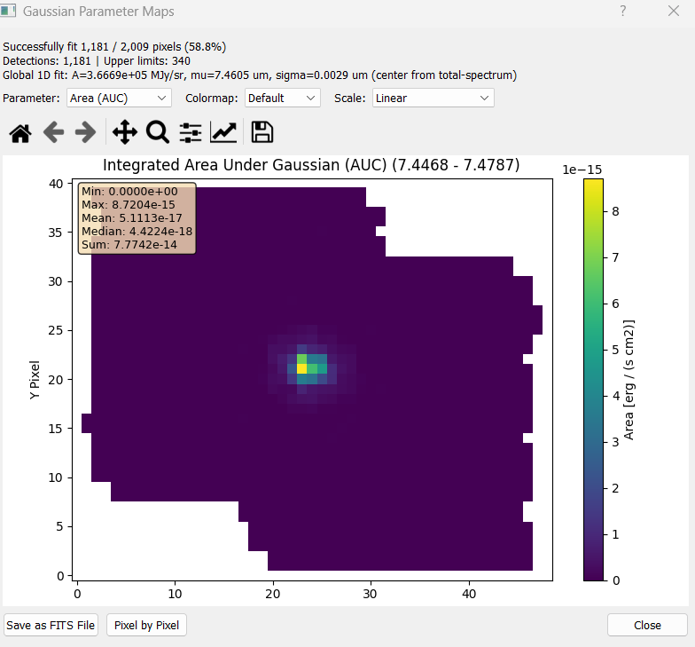

===========================
Pixel-by-Pixel Cube Fitting
===========================

Fit a Gaussian to the spectrum of **every spatial pixel** in the cube, producing 2D parameter
maps that show how the line properties vary across the field.

This is the full-cube counterpart to :doc:`gaussian_fitting_1d`. The per-pixel fit is the same
algorithm, but the workflow, the required inputs and the outputs are different: a noise region
becomes mandatory, non-detections are turned into upper limits rather than discarded, and the
result is a set of maps rather than a single number per parameter.

.. note::

   Running :doc:`gaussian_fitting_1d` first is not mandatory for a Gaussian map, but
   recommended.

Setting Up the Fit
==================

The cube fit reuses the same toggle buttons as the 1D fit. Set **Left** and **Right** to
bracket the line -- this becomes the fit window for every pixel.

**Peak is not used.** The cube fit derives its own center guess by fitting the summed
spectrum of the whole cube once, or from the nearest HITRAN catalog line in the window if
a line list is loaded. Your **Peak** click has no effect here.

**Noise region is mandatory.** Set **Noise L** and **Noise R** over a line-free stretch of
spectrum -- the fit will not start without them. The noise measured there sets the
detection threshold and the size of any upper limits.

.. _detection-caveat:

.. note::

   **"Detections" is not a strict 3σ cut.** A pixel can also be flagged as a detection with
   a weaker signal (down to about 0.5σ) as long as the fit converges — this is deliberate,
   meant to catch faint-but-real lines a strict cut would drop, at the cost of also letting
   some noise through. Treat the mask as "a Gaussian was fitted here", not as a significance
   cut, and apply your own SNR threshold before using an area map for science.

Running the Fit
===============

Click **Fit Gaussian Map** and confirm the prompt. A progress bar tracks completion, and
**Cancel** stops the run.

**Cost.** A bit expensive compared to the other fitting tools, but still manageable --
typically minutes, scaling with pixel count and window width.

**Results are cached.** Re-running with the same Left/Right *and* the same Noise L/Noise R
reuses the previous fit instead of recomputing it, and tells you so. Change any of the four
boundaries to force a fresh run.

Reading the Results
===================

The results window opens automatically when the fit completes, headed by a summary:

- **Successfully fit N / M pixels** — how many converged, e.g. from a real MIRI run:
  ``Successfully fit 1,181 / 2,009 pixels (58.8%)``
- **Detections | Upper limits** — how many pixels landed in each category (see
  :ref:`the detection note <detection-caveat>`), e.g. ``Detections: 1,181 | Upper limits: 340``
- **Global 1D fit** — the summed-spectrum fit used to seed the per-pixel initial guesses,
  and where its center came from, e.g.

  .. code-block:: text

      Global 1D fit: A=3.6669e+05 MJy/sr, mu=7.4605 um, sigma=0.0029 um (center from total-spectrum)

  ``center from total-spectrum`` means the seed came from fitting the summed cube. With a
  HITRAN list loaded it can instead come from the nearest catalog line in the window.
  ``A`` stays in the cube's native flux unit (not CGS-converted) -- unlike the Amplitude
  map below, this is just the initial guess used to seed every pixel's fit.

Below that, a dropdown selects which map to display, with colormap and scale controls
(Linear, Log, or Percentile 2–98%):

   The results window for a real MIRI run: the summary text above the dropdown, and the
   **Area (AUC)** map selected -- the colorbar confirms the CGS conversion (in
   erg/s/cm² units), and the overlay box gives Min/Max/Mean/Median/Sum for the whole
   displayed map.

Output Maps
===========

Available in the dropdown:

.. list-table::
   :header-rows: 1
   :widths: 25 75

   * - Map
     - Contents
   * - **Area (AUC)**
     - Integrated line flux per pixel, ``A × σ × √(2π)``. In **erg/s/cm²** for MIRI,
       NIRSpec and MUSE (see :ref:`the unit table on the 1D page <area-units-1d>`);
       otherwise in the cube's native flux×wavelength units.
   * - **Amplitude**
     - Peak height above the baseline, in the cube's **native flux unit** (e.g. MJy/sr) --
       unlike Area, this is *not* CGS-converted
   * - **Center**
     - Fitted line center wavelength — this is your velocity map, once converted
   * - **Sigma**
     - Gaussian σ, in the spectral axis unit
   * - **FWHM**
     - ``2.355 × σ``
   * - **chi2 (fit quality)**
     - Reduced χ², computed against the measured noise. Informational only — it does not
       affect which pixels count as detections.
   * - **Success Mask**
     - Binary map of converged pixels
   * - **Residuals**
     - Data minus fitted model. Display only — see the export note below.

Where every pixel goes
----------------------

Each pixel lands in exactly one of three states, and they account for the whole map. From
the MIRI run above:

.. list-table::
   :header-rows: 1
   :widths: 22 18 60

   * - State
     - Example
     - What is stored
   * - **Detection**
     - 1,181 (58.8%)
     - Converged and passed the detection test — which is **not** a 3σ cut, see
       :ref:`the detection caveat <detection-caveat>`. Every parameter populated.
   * - **Upper limit**
     - 340 (16.9%)
     - ``area`` holds an upper limit; amplitude, center, sigma, FWHM and χ²_red are **NaN**.
   * - **No data**
     - 488 (24.3%)
     - The spectrum was entirely NaN — outside the field of view. Everything is NaN and
       *no* flag is set, so these pixels appear in neither mask.

1,181 + 340 + 488 = 2,009. If your three numbers do not add up to the pixel count,
something is wrong with the window or the cube.

.. note::

   The exact counts are not reproducible to the pixel — identical runs can differ by a
   few pixels due to floating-point non-determinism inside ``curve_fit``.

Upper limits
------------

For pixels that fail the detection threshold the area is **not** set to NaN. It is replaced
with an upper limit at the detection threshold, and the pixel is flagged in the
``is_upper_limit`` mask.

.. warning::

   ``is_upper_limit`` is set by **several** paths, not only "amplitude below threshold": a
   window with fewer than 5 finite samples, a failed noise estimate, and an exception inside
   the fit all land here too. In the last case, if the failure happened before an initial σ
   guess existed, ``area`` is **NaN while** ``is_upper_limit`` **is True**.

Exporting Maps as FITS
======================

With a map selected in the dropdown, click **Save as FITS File**. Each map is written as a
single-slice FITS file you can reopen in the 2D viewer (:doc:`2d_viewer`) or in external
tools.

The header of each exported map carries the fit's provenance: ``LAMMIN``/``LAMMAX`` for the
window, ``NSUCC``/``NTOTAL`` for the detection count, ``PARAM`` for which map it is, and
``BUNIT`` set to the same unit shown on the colorbar.

.. note::

   **Residuals export as a 3D cube, not a 2D map.** Selecting **Residuals** and clicking
   **Save as FITS File** writes the full normalized residual cube — shape
   ``(n_wave, n_y, n_x)`` over the fit window, with ``BUNIT = 'Normalized residuals'`` —
   even though the dialog only ever displays the middle wavelength slice. The API
   equivalent is ``export_residual_cube`` (below).

Using the API
=============

**Fitting the cube**

.. code-block:: python

    from cube_explorer.api import load_cube, create_gaussian_map

    cube = load_cube("data.fits")

    maps = create_gaussian_map(
        cube,
        lam_min=7.446784,        # Left boundary
        lam_max=7.478707,        # Right boundary
        noise_min=7.516742,      # Line-free region, as in the GUI
        noise_max=7.562928,
        fac_above_stdres=3.0,    # Detection threshold in sigma
        n_jobs=8,
    )

    print(f"Detections:   {maps['is_detection'].sum()}")
    print(f"Upper limits: {maps['is_upper_limit'].sum()}")
    print(f"No data:      {maps['area'].size - maps['is_detection'].sum() - maps['is_upper_limit'].sum()}")

    area_map = maps['area']          # 2D array, shape (n_y, n_x)

**Returned keys**

.. code-block:: python

    maps['amplitude']         # Peak amplitude, in the cube's native flux unit (e.g. MJy/sr)
    maps['center']            # Line center wavelength
    maps['sigma']             # Gaussian sigma
    maps['fwhm']              # 2.355 * sigma
    maps['area']              # Integrated flux, or an upper limit - check is_upper_limit
    maps['success']           # Boolean: did the pixel converge and pass the detection test?
    maps['is_upper_limit']    # Boolean: area is an upper limit (may still be NaN)
    maps['residuals_cube']    # 3D residuals cached during fitting
    maps['fac_above_stdres']  # The threshold that was used
    maps['wavelength_unit']   # Spectral axis unit string
    maps['global_fit']        # The summed-spectrum fit used for initial guesses (also
                               # native-unit amplitude)

.. note::

   ``amplitude`` and ``area`` are **not** converted the same way. ``amplitude`` stays in
   the cube's native flux unit; only ``area`` is CGS-converted (to erg/s/cm², when the
   header has the pixel scale needed for the conversion).

**Exporting a residual cube**

Fits and subtracts a Gaussian at every pixel, writing the normalized residuals to a 3D FITS
file:

.. code-block:: python

    from cube_explorer.api import load_cube, export_residual_cube

    cube = load_cube("data.fits")

    export_residual_cube(
        cube,
        out_path="residual.fits",
        lam_min=7.492291,
        lam_max=7.517421,
    )

    # Or keep the array in memory as well
    path, residuals = export_residual_cube(
        cube, out_path="residual.fits",
        lam_min=7.492291, lam_max=7.517421, return_cube=True,
    )

Constraints and Tips
====================

1. **Left < Right**, and the noise region must be set — the run will not start otherwise
2. Keep the noise region **close in wavelength** to the fit window. Detector noise varies
   with wavelength, so a distant noise estimate misstates the detection threshold across
   the whole map
3. Keep the fit window **tight**. Every extra wavelength sample is fitted for every pixel,
   so a window twice as wide costs roughly twice the runtime and degrades χ²_red
4. Always check the **Success Mask** and the detection/upper-limit counts before
   interpreting a parameter map
5. Use the **χ²** map to find where the model breaks down

Next Steps
==========

- :doc:`rotational_diagram` — turn per-pixel line fluxes into temperatures, handling the
  upper limits correctly
- :doc:`co_flux_extraction` — simultaneous multi-line fitting for CO rovibrational bands
- :doc:`exporting_data` — other export paths
- :doc:`2d_viewer` — open the exported parameter maps with WCS support
