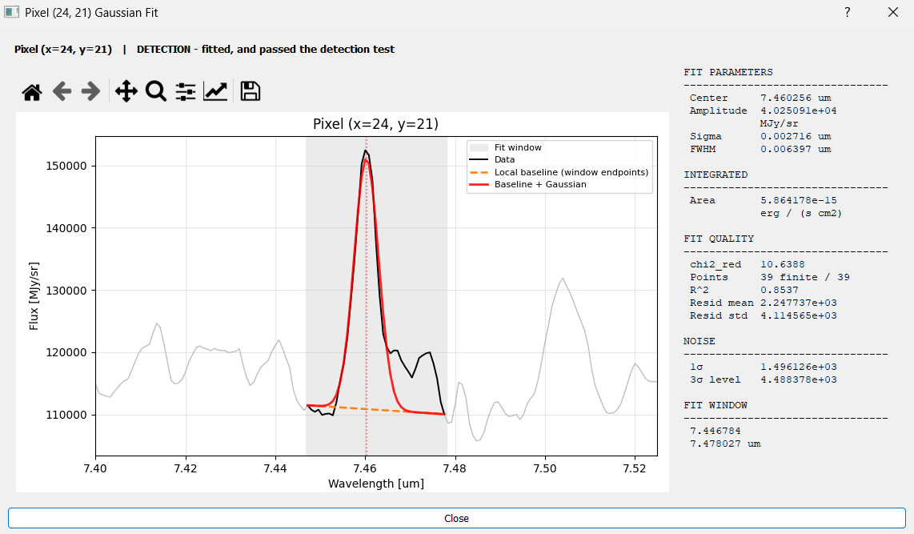

===========================
Pixel-by-Pixel Cube Fitting
===========================

Fit a Gaussian to the spectrum of **every spatial pixel** in the cube, producing 2D parameter
maps that show how the line properties vary across the field.

This is the full-cube counterpart to :doc:`gaussian_fitting_1d`. The per-pixel fit is the same
algorithm, but the workflow, the required inputs and the outputs are different: a noise region
becomes mandatory, non-detections are turned into upper limits rather than discarded, and the
result is a set of maps rather than a single number per parameter.

.. note::

   Running :doc:`gaussian_fitting_1d` first is not mandatory for a Gaussian map, but
   recommended.

Setting Up the Fit
==================

The cube fit reuses the same buttons as the 1D fit. Set **Fit Left** and **Fit Right** to
bracket the line; this becomes the fit window for every pixel.

**Peak is not used.** The cube fit derives its own center guess by fitting the summed
spectrum of the whole cube once, or from the nearest HITRAN catalog line in the window if
a line list is loaded. Your **Peak** click has no effect here.

**Noise region is mandatory.** Set **Noise Left** and **Noise Right** over a line-free stretch
of spectrum: the fit will not start without them ("Noise Region Required"). The region
needs at least 4 wavelength samples ("Noise Region Too Narrow"). The noise measured there
sets the detection threshold and the size of any upper limits.

**Left Region and Right Region tabs.** On one of these tabs, select a region of more than
one pixel first. A single point is not enough ("Region Selection Required"). The fit
runs on the whole cube, and the maps show values only inside your region.

.. _detection-caveat:

.. note::

   **A detection is a 3σ detection.** A pixel counts as a detection only when the fit
   converged **and** the fitted amplitude is at least 3 times the noise. The noise comes from
   your noise region, and the 3σ threshold is fixed in the GUI. A pixel that fails the test
   becomes an upper limit instead.

Running the Fit
===============

Click **Fit Gaussian Map** and confirm the prompt ("Continue with map fitting?"). A
"Gaussian Map Fitting" window tracks completion, and **Cancel** stops the run.

**Cost.** A bit expensive compared to the other fitting tools, but still manageable --
typically minutes, scaling with pixel count and window width.

**Results are cached.** Re-running with the same Fit Left/Fit Right *and* the same Noise
Left/Noise Right, on the same tab, reuses the previous fit instead of recomputing it, and
tells you so ("Cached Results"). Change any of the four boundaries to force a fresh run.

Reading the Results
===================

The "Gaussian Parameter Maps" window opens automatically when the fit completes. It starts
with a headline: ``Successfully fit N / M pixels (x%)``. This counts the pixels where the fit
converged. Click **Show Statistics** for the full breakdown:

- **Successfully fit** — how many pixels converged
- **Detections** — pixels that converged and passed the 3σ test (see
  :ref:`the detection note <detection-caveat>`)
- **Upper limits** — pixels that failed the test. If some fits never ran (too few finite
  samples, or an error inside the fit), the window says how many
- **No data** — pixels with no valid spectrum, for example outside the field of view

The same dialog shows the minimum, maximum, mean, median, and standard deviation of the map
that you selected.

Below the headline, the **Parameter** dropdown selects which map to display. Next to it are
the **Colormap** dropdown and the **Scale…** button (Linear, Log, or Power, with an absolute
or a percentile color range):

.. figure:: ../_static/area_under_gaussian.png
   :alt: Gaussian Parameter Maps results window showing the Area (AUC) map for a real MIRI cube fit
   :width: 100%

   The results window for a real MIRI run: the summary text above the dropdown, and the
   **Area (AUC)** map selected. The colorbar confirms the CGS conversion (in
   erg/s/cm² units), and the overlay box gives Min/Max/Mean/Median/Sum for the whole
   displayed map.

Output Maps
===========

Available in the dropdown:

.. list-table::
   :header-rows: 1
   :widths: 25 75

   * - Map
     - Contents
   * - **Area (AUC)**
     - Integrated line flux per pixel, ``A × σ × √(2π)``. In **erg/s/cm²** for MIRI,
       NIRSpec and MUSE (see :ref:`the unit table on the 1D page <area-units-1d>`);
       otherwise in the cube's native flux×wavelength units.
   * - **Area Error**
     - Uncertainty of the area, in the same unit as Area. NaN where the pixel is not a detection
   * - **Amplitude**
     - Peak height above the baseline, in the cube's **native flux unit** (e.g. MJy/sr) --
       unlike Area, this is *not* CGS-converted
   * - **Center**
     - Fitted line center wavelength
   * - **Velocity**
     - Doppler velocity of the fitted center, in km/s. Zero velocity is the center of the fit
       to the summed spectrum (shown in **Show Statistics**). If that fit did not converge,
       the window says that the map is unavailable
   * - **Sigma**
     - Gaussian σ, in the spectral axis unit
   * - **FWHM**
     - ``2.355 × σ``
   * - **chi2 (fit quality)**
     - Reduced χ², computed against the measured noise. Informational only — it does not
       affect which pixels count as detections.
   * - **Fit Status**
     - One value for each pixel: 0 = no data, 1 = upper limit, 2 = detection. See the table below
   * - **Success Mask**
     - Binary map of converged pixels
   * - **Residuals**
     - Data minus fitted model. Display only — see the export note below.

Where every pixel goes
----------------------

Each pixel lands in exactly one of three states, and they account for the whole map. The
**Fit Status** map shows the state of each pixel, and **Show Statistics** counts them:

.. list-table::
   :header-rows: 1
   :widths: 22 12 66

   * - State
     - Status
     - What is stored
   * - **Detection**
     - 2
     - Converged and passed the 3σ test, see
       :ref:`the detection note <detection-caveat>`. Every parameter populated.
   * - **Upper limit**
     - 1
     - ``area`` holds an upper limit; amplitude, center, sigma, FWHM and χ²_red are **NaN**.
   * - **No data**
     - 0
     - The spectrum was entirely NaN — outside the field of view. Everything is NaN and
       *no* flag is set, so these pixels appear in neither mask.

The three counts must add up to the pixel count. If they do not, something is wrong with the
window or the cube.

.. note::

   The exact counts are not reproducible to the pixel — identical runs can differ by a
   few pixels due to floating-point non-determinism inside ``curve_fit``.

Upper limits
------------

For pixels that fail the detection threshold the area is **not** set to NaN. It is replaced
with an upper limit at the detection threshold, and the pixel is flagged in the
``is_upper_limit`` mask.

.. warning::

   ``is_upper_limit`` is set by **several** paths, not only "amplitude below threshold": a
   window with fewer than 5 finite samples, a failed noise estimate, and an exception inside
   the fit all land here too. In the last case, if the failure happened before an initial σ
   guess existed, ``area`` is **NaN while** ``is_upper_limit`` **is True**. The ``fit_failed``
   mask marks the pixels whose fit never ran.

Inspecting Individual Pixels
=============================

With **Pixel Select: ON** (the default), clicking a pixel on the map opens that pixel's own
fit, the same control as :doc:`flux_extraction`'s pixel inspector, but for a single
Gaussian instead of a multi-line fit. Turn **Pixel Select** to OFF to zoom/pan the map
freely instead of reopening this dialog on every click.

   The stored fit for one pixel: data, the local endpoint-to-endpoint baseline, and the
   fitted Gaussian, with every parameter the map holds for that pixel listed alongside.
   This is exactly what the map contains, not a fresh re-fit.

.. note::

   The dialog never re-fits anything: it only redraws what ``fit_gaussians_per_pixel``
   already stored for that pixel, so what you see here always matches the map.

Exporting Maps as FITS
======================

With a map selected in the dropdown, click **Save as FITS File**. Each map is written as a
single-slice FITS file you can reopen in the 2D viewer (:doc:`2d_viewer`) or in external
tools.

The header of each exported map carries the fit's provenance: ``LAMMIN``/``LAMMAX`` for the
window, ``NSUCC``/``NTOTAL`` for the number of successful fits and the number of pixels, ``PARAM`` for which map it is, and
``BUNIT`` set to the same unit shown on the colorbar.

.. note::

   **Residuals export as a 3D cube, not a 2D map.** Selecting **Residuals** and clicking
   **Save as FITS File** writes the full normalized residual cube — shape
   ``(n_wave, n_y, n_x)`` over the fit window, with ``BUNIT = 'Normalized residuals'`` —
   even though the dialog only ever displays the middle wavelength slice. The API
   equivalent is ``export_residual_cube`` (below).

Using the API
=============

**Fitting the cube**

.. code-block:: python

    from cube_explorer.api import load_cube, create_gaussian_map

    cube = load_cube("data.fits")

    maps = create_gaussian_map(
        cube,
        lam_min=7.446784,        # Left boundary
        lam_max=7.478707,        # Right boundary
        noise_min=7.516742,      # Line-free region, as in the GUI
        noise_max=7.562928,
        fac_above_stdres=3.0,    # Detection threshold in sigma
        n_jobs=8,
    )

    print(f"Detections:   {maps['is_detection'].sum()}")
    print(f"Upper limits: {maps['is_upper_limit'].sum()}")
    print(f"No data:      {maps['area'].size - maps['is_detection'].sum() - maps['is_upper_limit'].sum()}")

    area_map = maps['area']          # 2D array, shape (n_y, n_x)

**Returned keys**

.. code-block:: python

    maps['amplitude']         # Peak amplitude, in the cube's native flux unit (e.g. MJy/sr)
    maps['amplitude_error']   # Amplitude uncertainty
    maps['center']            # Line center wavelength
    maps['sigma']             # Gaussian sigma
    maps['fwhm']              # 2.355 * sigma
    maps['area']              # Integrated flux, or an upper limit - check is_upper_limit
    maps['area_error']        # Area uncertainty (NaN where the pixel is not a detection)
    maps['r_squared']         # Reduced chi-squared (the "chi2" map in the GUI)
    maps['success']           # Boolean: did the fit converge?
    maps['is_detection']      # Boolean: converged and amplitude >= fac_above_stdres * noise
    maps['is_upper_limit']    # Boolean: area is an upper limit (may still be NaN)
    maps['fit_failed']        # Boolean: the part of is_upper_limit whose fit never ran
    maps['residuals_cube']    # 3D residuals cached during fitting
    maps['fac_above_stdres']  # The threshold that was used
    maps['wavelength_unit']   # Spectral axis unit string
    maps['global_fit']        # The summed-spectrum fit used for initial guesses (also
                               # native-unit amplitude)

.. note::

   ``amplitude`` and ``area`` are **not** converted the same way. ``amplitude`` stays in
   the cube's native flux unit; only ``area`` is CGS-converted (to erg/s/cm², when the
   header has the pixel scale needed for the conversion).

**Exporting a residual cube**

Fits and subtracts a Gaussian at every pixel, writing the normalized residuals to a 3D FITS
file:

.. code-block:: python

    from cube_explorer.api import load_cube, export_residual_cube

    cube = load_cube("data.fits")

    export_residual_cube(
        cube,
        out_path="residual.fits",
        lam_min=7.492291,
        lam_max=7.517421,
    )

    # return_cube=True returns the array INSTEAD of writing a file --
    # out_path is ignored in this mode, it's not written in addition
    residuals = export_residual_cube(
        cube, lam_min=7.492291, lam_max=7.517421, return_cube=True,
    )

Constraints and Tips
====================

1. **Fit Left < Fit Right**, and the noise region must be set (at least 4 samples) — the
   run will not start otherwise. On the Left Region or Right Region tab, you also need a
   region of more than one pixel
2. Keep the noise region **close in wavelength** to the fit window. Detector noise varies
   with wavelength, so a distant noise estimate misstates the detection threshold across
   the whole map
3. Keep the fit window **tight**. Every extra wavelength sample is fitted for every pixel,
   so a window twice as wide costs roughly twice the runtime and degrades χ²_red
4. Always check the **Success Mask** and the detection/upper-limit counts before
   interpreting a parameter map
5. Use the **χ²** map to find where the model breaks down

Next Steps
==========

- :doc:`rotational_diagram` — turn per-pixel line fluxes into temperatures, handling the
  upper limits correctly
- :doc:`flux_extraction` — simultaneous multi-line fitting for rovibrational bands, any species
- :doc:`exporting_data` — other export paths
- :doc:`2d_viewer` — open the exported parameter maps with WCS support
