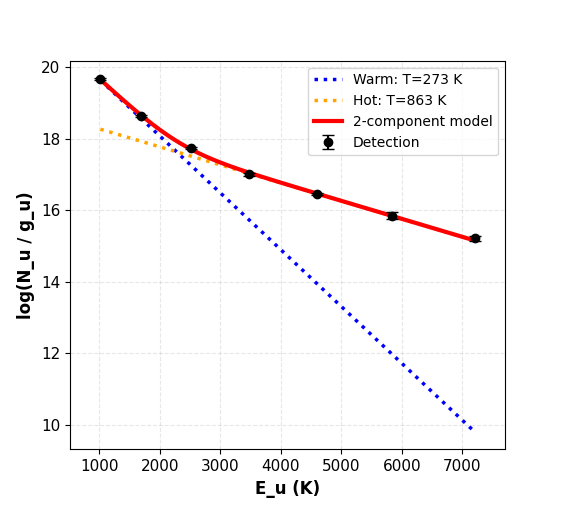
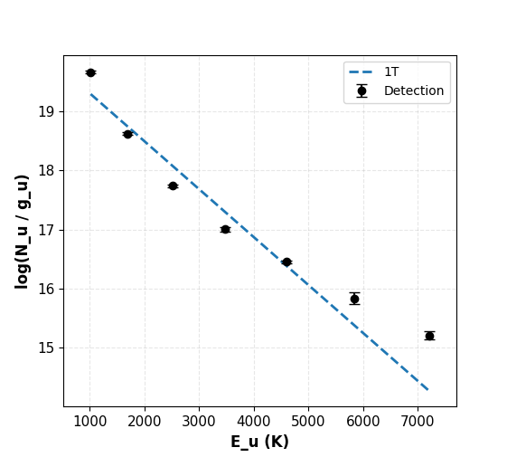
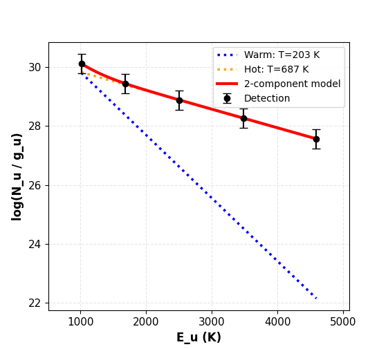

==================
Rotational Diagram
==================

Fit rotational excitation temperatures from a set of line fluxes (H2 or CO), using a
single-temperature (1T) or two-temperature (2T) model, with an optional grid search over
the ortho-to-para ratio (OPR) for H2.

Using the Rotational Diagram Tool
==================================

**Accessing the Tool**

1. Click the **Rot Diag** button in the main toolbar (**Rotational Diagram** group)

**Step 1: Get Line Data**

Two ways to populate the line table:

- **Fetch from HITRAN** — set the wavelength range (μm), molecule (**H2** or **CO**) and
  isotopologue, and either check **All transitions** or specify ``v_upper``/``v_lower``,
  then click **Fetch from HITRAN**. Populates the table with every matching line's
  wavelength, A coefficient, E\ :sub:`upper` and statistical weight — the flux columns are
  left blank for you to fill in.
- **Import from CSV** — load a file with ``species``, ``wavelength`` and ``flux`` columns
  (a column with "error" in its name is optional), e.g. ``data/H2_lines.csv``. Each row is
  matched to the nearest HITRAN line by wavelength to fill in A/E\ :sub:`upper`/g\ :sub:`upper`
  automatically, and its flux (and error, if present) populate the table directly.

A **Calculate Fluxes** button also appears once HITRAN lines are fetched, for measuring
fluxes directly from the loaded cube instead of entering them by hand.

**Step 2: Select Lines and Enter Flux Data**

The table shows every fetched/imported line:

- **☑** — include this line in the fit
- **λ (μm)**, **Transition**, **A_ul (s⁻¹)**, **E_u (K)**, **g_u** — from HITRAN, not editable
- **Flux**, **Flux Error**, **Error %** — enter a flux and either an absolute error or a
  percentage; the two error columns auto-calculate from each other as you type (toggle
  which one drives the calculation with the **Error input** dropdown above the table)
- **Upper Limit?** — check this instead of entering an error for a non-detection

.. important::

   Detections need a flux error — a detection with no error entered is silently dropped
   from the fit rather than assigned a made-up default (you'll get a popup listing which
   lines were excluded, if any). Upper limits are the exception: they don't need an error,
   just the checkbox.

   If *any* line is marked as an upper limit, the fit automatically switches from ordinary
   least-squares to a Bayesian censored regression (PyMC) that treats upper limits as
   one-sided constraints rather than dropping or fudging them — this happens transparently,
   there's no separate mode to select.

**Step 3: Set Physical Parameters and Fit Options**

- **R (AU)** — emitting region radius. Check **Unknown R** to skip it entirely; N\ :sub:`u`
  is then reported as a total molecule count rather than a column density (e.g. for
  comparing against PDRToolbox/PDRT).
- **Distance (pc)**
- **Fit** — **1T** or **2T**
- **Fit OPR** — grid-search the ortho-to-para ratio to minimize χ² instead of assuming the
  fixed equilibrium value **OPR = 3**. Only affects H2 S-branch lines. Click **▶ Advanced**
  to override the search grid (default: OPR from 0.1 to 3.0 in 400 steps).

**Step 4: Run Fit → Results**

Click **Run Fit**. The results window shows both text and a plot:

- **Detections** — black points with error bars
- **Upper limits** — red downward-pointing arrows (no error bar, since the constraint is
  one-sided)
- **1T mode**: a single dashed line through the points
- **2T mode**: dotted **Warm**/**Hot** lines for each component, plus a solid red
  **2-component model** line for their sum
- Y-axis is log\ :sub:`10`\ (N\ :sub:`u` / g\ :sub:`u`), not natural log, despite the fit
  internally working in ln space

If **Fit OPR** was checked, the text results also report the best-fit OPR and its 1σ range.

Worked Examples
================

The dataset here is the standard H2 v=0→0 S(1)–S(7) pure-rotational line set (5.5–17 µm),
imported from ``data/H2_lines.csv``.

   2T fit (OPR fixed at 3) on all 7 lines — Warm (273 K) and Hot (863 K) components.

   1T fit on the *same* 7 lines. The single line can't track the curvature — the
   highest-E\ :sub:`u` point sits well below it — which is exactly the signature that
   motivates using 2T here instead.

   2T fit with **Fit OPR** enabled, on the 5 highest-E\ :sub:`u` lines only and larger
   (75%) flux errors — a messier, more realistic case. The OPR search converged to 1.859.

Using the API
==============

``rotational_diagram()`` is not a separate wrapper — it's the exact function the GUI calls,
imported directly. There's no GUI/API divergence to account for here, unlike CO flux above.

.. code-block:: python

    from cube_explorer.api import rotational_diagram

    # H2 v=0->0 S(1)-S(7), matching data/H2_lines.csv, matched against HITRAN
    molecular_data = {
        'wavelengths': {1: 17.034846, 2: 12.278612, 3: 9.664911, 4: 8.025041,
                        5: 6.909509, 6: 6.108564, 7: 5.511183},
        'Aul': {1: 4.758e-10, 2: 2.753e-9, 3: 9.83e-9, 4: 2.641e-8,
                5: 5.876e-8, 6: 1.141e-7, 7: 2.0e-7},
        'Eu': {1: 1015.947, 2: 1683.068, 3: 2505.873, 4: 3477.452,
               5: 4589.958, 6: 5834.798, 7: 7202.827},
        'gu': {1: 7, 2: 9, 3: 11, 4: 13, 5: 15, 6: 17, 7: 19},  # bare 2*J_upper+1;
            # apply_OPR() applies the ortho/para nuclear-spin weighting on top of this
    }

    result = rotational_diagram(
        fluxes={1: 178e-16, 2: 55.9e-16, 3: 122e-16, 4: 28.4e-16,
                5: 72.3e-16, 6: 14.4e-16, 7: 22.2e-16},
        flux_errors={1: 9e-16, 2: 3.2e-16, 3: 6.3e-16, 4: 2.4e-16,
                     5: 4e-16, 6: 3.2e-16, 7: 3.8e-16},
        molecular_data=molecular_data,
        R=8.5,      # AU
        dist=71.5,  # pc
        fit2T=True,
    )
    print(f"1T Temperature: {result['1T']['T']:.1f} K")
    print(f"2T Temperatures: {result['2T']['T1']:.1f} K, {result['2T']['T2']:.1f} K")

This reproduces the first worked example above exactly (273.4 K / 863.4 K).

.. important::

   A 2T fit has 4 free parameters — you need meaningfully more than 4 lines for the fit
   (and its uncertainties) to mean anything. Passing ``fit2T=True`` with too few points
   doesn't raise an error; it just silently returns a degenerate fit with huge, useless
   uncertainties.

   ``fluxes``/``flux_errors``/``molecular_data`` are all keyed by an arbitrary integer (the
   GUI uses upper rotational level J, but any hashable key works, as long as it's
   consistent across the four dicts). Pass ``upper_limits={key: True}`` for non-detections
   to switch on the same censored PyMC fit the GUI uses automatically — see the upper-limit
   note in the GUI section above.

**Tips**

- ``R=None`` (or omitting it) reports N\ :sub:`u` as a total molecule count instead of a
  column density, matching the GUI's **Unknown R** checkbox.
- Pass ``fit_opr=True`` (and optionally ``opr_grid=np.linspace(...)``) to search for the
  best-fit OPR instead of fixing it at 3 — matching the third worked example above.
