==================
Rotational Diagram
==================

Fit rotational excitation temperatures from a set of line fluxes (H2 or CO), using a
single-temperature (1T) or two-temperature (2T) model, with an optional grid search over
the ortho-to-para ratio (OPR) for H2.

Using the Rotational Diagram Tool
==================================

**Accessing the Tool**

1. Click the **Rot Diag** button in the main toolbar (**Rotational Diagram** group)

**Step 1: Get Line Data**

Two ways to populate the line table:

- **Fetch from HITRAN** — set the wavelength range (μm), molecule (**H2** or **CO**) and
  isotopologue, and either check **All transitions** or specify ``v_upper``/``v_lower``,
  then click **Fetch from HITRAN**. Populates the table with every matching line's
  wavelength, A coefficient, E\ :sub:`upper` and statistical weight — the flux columns are
  left blank for you to fill in.
- **Import from CSV** — load a file with ``species``, ``wavelength`` and ``flux`` columns
  (a column with "error" in its name is optional, and so is ``upper_limit`` -- the format
  **Save Fluxes** writes), e.g. ``data/H2_lines.csv``. Each row is matched to the nearest
  HITRAN line by wavelength to fill in A/E\ :sub:`upper`/g\ :sub:`upper` automatically, and
  its flux (and error/upper-limit, if present) populate the table directly. If every row is
  the same molecule and it isn't the one currently selected above, the **Molecule** dropdown
  switches to match.

A **Calculate Fluxes** button also appears once HITRAN lines are fetched, for measuring
fluxes directly from a loaded cube instead of entering them by hand. Every line covered by
the same FITS file is fit simultaneously via ``curve_fit`` (the same chunked engine as
:doc:`flux_extraction`'s **Multi-Gaussian Fit**, not a separate implementation), and the
results, including flux error, upper-limit status, and fit quality, are written straight
into the table below.

Once fluxes are in the table, **Save Fluxes** writes every checked line's species,
wavelength, flux, flux error, and upper-limit flag to a CSV -- the same format
**Import from CSV** reads. Selecting the same lines again later is then an import, not a
re-run of Calculate Fluxes. An upper limit's real flux error is saved too, not lost just
because the checkbox hides it from the table -- and re-importing checks **Upper Limit?**
again automatically instead of showing it as a plain detection.

**Step 2: Select Lines and Enter Flux Data**

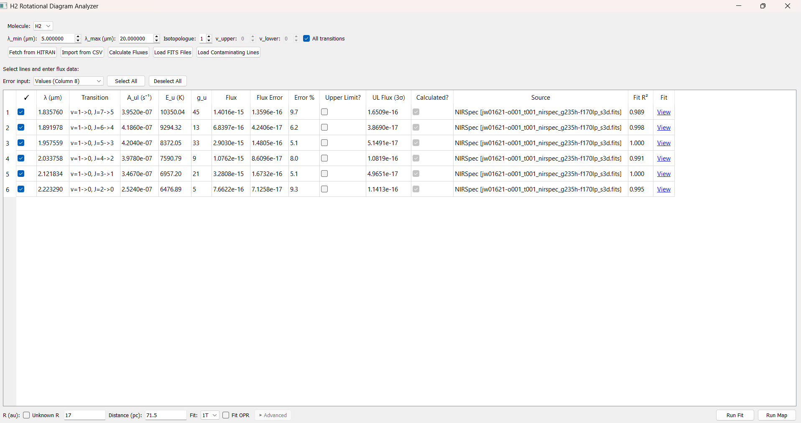

   The line table -- ☑, HITRAN columns, flux/error columns, and the Calculate-Fluxes-only
   columns described below -- with **Run Fit** and **Run Map** at the bottom right.

The table shows every fetched/imported line, in three groups of columns:

- **☑**, **λ (μm)**, **Transition**, **A_ul (s⁻¹)**, **E_u (K)**, **g_u** — from HITRAN, not
  editable. ☑ controls whether the line is included in the fit.
- **Flux**, **Flux Error**, **Error %**, **Upper Limit?** — enter by hand, or let
  **Calculate Fluxes** fill them in. A flux and either an absolute error or a percentage
  auto-calculate from each other as you type (toggle which one drives the calculation with
  the **Error input** dropdown above the table). Check **Upper Limit?** instead of entering
  an error for a non-detection.
- **UL Flux (3σ)**, **Calculated?**, **Source**, **Fit R²**, **Fit** — only
  filled in by **Calculate Fluxes**:

  - **UL Flux (3σ)**: the 3σ upper-limit flux for this line, computed the same way whether
    the line is a detection or not:

    .. math::

       F_{UL} = 3 \sigma_{noise} \cdot \sigma \cdot \sqrt{2\pi}

    the same area formula every fit in this app uses (:math:`A \sigma \sqrt{2\pi}`), but
    with :math:`3 \sigma_{noise}` (three times the noise level) standing in for the
    fitted amplitude :math:`A`, and :math:`\sigma` the line's real instrumental width
  - **Calculated?**: checked if this row's flux came from **Calculate Fluxes** rather than
    manual entry
  - **Source**: which instrument and FITS file the flux was measured from
  - **Fit R²**: quality of the underlying Gaussian fit, flagged red below 0.5 (the same
    threshold used elsewhere in the app)
  - **Fit**: click to open a plot of this line's own fit (spectrum, baseline, fitted curve,
    flux, amplitude, R², FWHM), the same style as **Multi-Gaussian Fit**'s display

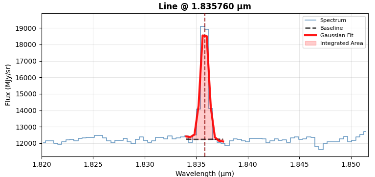

   Clicking **Fit** for one row opens this plot -- spectrum, fitted baseline, and the
   Gaussian fit shaded to show the integrated area.

.. important::

   Detections need a flux error. A detection with no error entered is silently dropped
   from the fit rather than assigned a made-up default (you'll get a popup listing which
   lines were excluded, if any). Upper limits are the exception: they don't need an error,
   just the checkbox.

   If *any* line is marked as an upper limit, the fit automatically switches from
   ``curve_fit`` to a Bayesian censored regression that treats upper limits as one-sided
   constraints rather than dropping them. The model itself is built in PyMC, but sampled
   with `nutpie <https://github.com/pymc-devs/nutpie>`_, a faster compiled NUTS sampler --
   the results text still labels diagnostics ``[PyMC: ...]`` since PyMC is what defines the
   model either way.

**How Calculate Fluxes measures a line**

Flux error combines two terms in quadrature:

- **Statistical** — from the error-propagation formula for
  :math:`\text{area} = A \sigma \sqrt{2\pi}`, assuming amplitude and sigma are
  uncorrelated:

  .. math::

     \sigma_{area} = \sqrt{2\pi \left(\sigma^2 \sigma_A^2 + A^2 \sigma_\sigma^2\right)}

  using ``curve_fit``'s own covariance for :math:`\sigma_A` and :math:`\sigma_\sigma`.
- **Systematic** — a fixed 5% of the flux, representing flux-calibration and
  continuum-estimation uncertainty that doesn't shrink just because a particular fit was
  well-constrained.

A line is classified as an upper limit if its fitted flux doesn't clear the 3σ threshold
above. **Calculate Fluxes** auto-checks **Upper Limit?** for those lines, though you can
still override the checkbox by hand afterward.

**Step 3: Set Physical Parameters and Fit Options**

- **R (AU)** — emitting region radius. Check **Unknown R** to skip it entirely; N\ :sub:`u`
  is then reported as a total molecule count rather than a column density.
- **Distance (pc)**
- **Fit** — **1T** or **2T**
- **Fit OPR** — grid-search the ortho-to-para ratio to minimize χ² instead of assuming the
  fixed equilibrium value **OPR = 3**. Only affects H2 S-branch lines. Click **▶ Advanced**
  to override the search grid (default: OPR from 0.1 to 3.0 in 400 steps).

**Step 4: Run Fit → Results**

Click **Run Fit**. The results window shows both text and a plot:

- **Detections** — black points with error bars
- **Upper limits** — red downward-pointing arrows (no error bar, since the constraint is
  one-sided)
- **1T mode**: a single dashed line through the points
- **2T mode**: dotted **Warm**/**Hot** lines for each component, plus a solid red
  **2-component model** line for their sum
- Y-axis is log\ :sub:`10`\ (N\ :sub:`u` / g\ :sub:`u`), not natural log, despite the fit
  internally working in ln space

If **Fit OPR** was checked, the text results also report the best-fit OPR and its 1σ range.

When any line is an upper limit, the censored (PyMC) fit also reports its own convergence
diagnostics: ``divergence(s)`` (ideally 0) and ``max r_hat`` (should be at most 1.01), so a
fit that struggled to sample doesn't look identical to one that converged cleanly.

**Run Map**, next to **Run Fit**, repeats this exact fit at every pixel of the loaded cube
instead of once on the whole-cube summed spectrum -- see *Creating a Rotational Diagram Map*
below.

Worked Examples
================

The dataset here is the standard H2 v=0→0 S(1)–S(7) pure-rotational line set (5.5–17 µm),
imported from ``data/H2_lines.csv``.

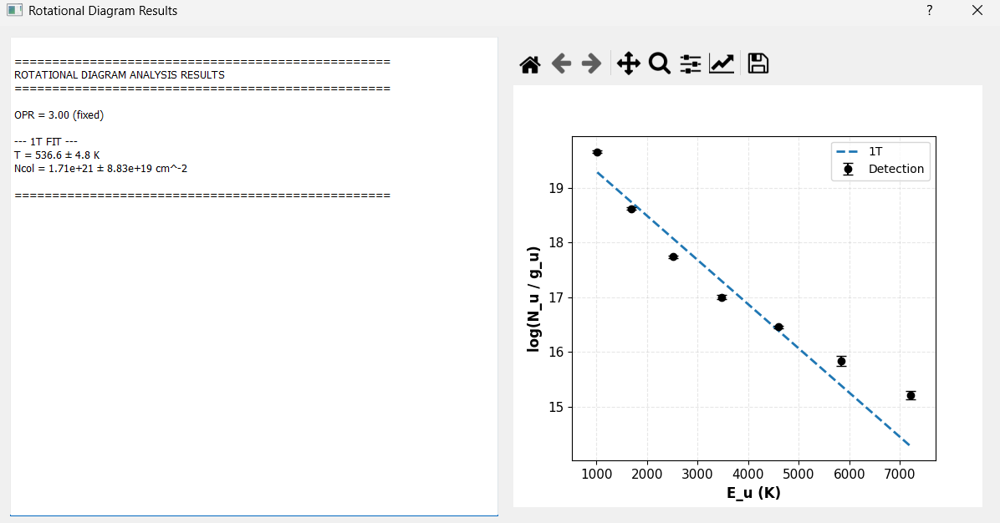

   1T fit on all 7 lines: T = 536.6 ± 4.8 K. The single line can't track the curvature,
   since the highest-E\ :sub:`u` points sit well below it, which is exactly the signature
   that motivates using 2T here instead.

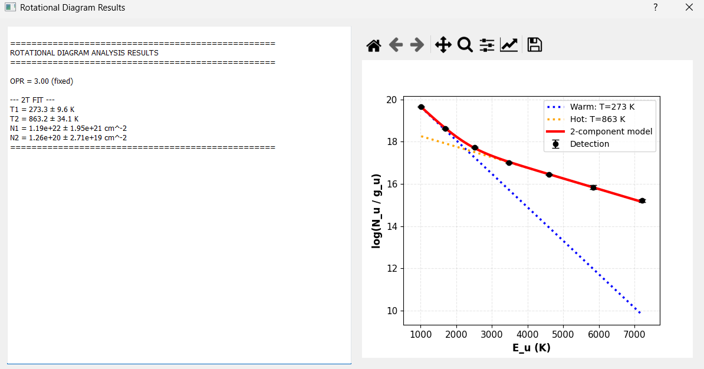

   2T fit (OPR fixed at 3) on the *same* 7 lines: Warm (T = 273.3 ± 9.6 K) and Hot
   (T = 863.2 ± 34.1 K) components, tracking the curvature the 1T fit missed.

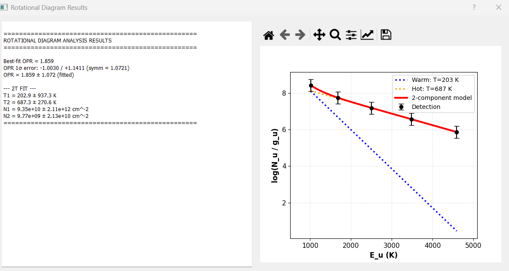

   2T fit with **Fit OPR** enabled, on the 5 highest-E\ :sub:`u` lines only and larger
   flux errors — a messier, more realistic case. The OPR search converged to 1.859 ± 1.072;
   with only 5 points feeding a 4-parameter 2T model plus OPR, T1's own uncertainty balloons
   (202.9 ± 937.3 K) even though the fit still runs.

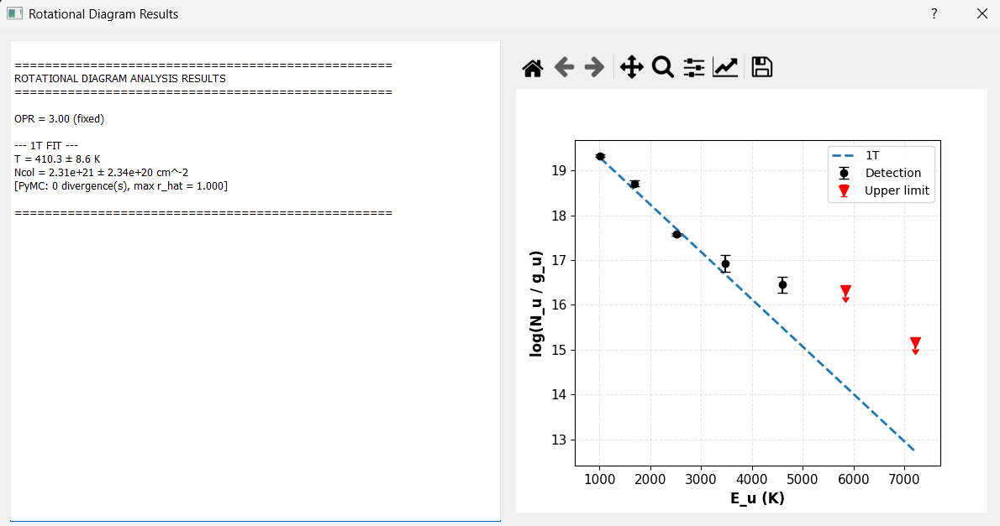

   1T fit on ``data/H2_lines_noflux.csv`` (flux and flux error left blank for every line;
   each is instead measured via **Calculate Fluxes**): 6 lines measured, 4 clearing the 3σ
   threshold as detections and 2 falling below it, auto-marked as upper limits (red arrows).
   T = 394.6 ± 8.4 K. The results text reports ``[PyMC: 0 divergence(s), max r_hat = 1.010]``
   since marking any line as an upper limit switches this to the censored PyMC fit
   automatically.

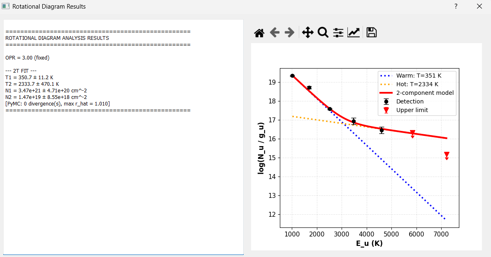

   2T fit on the same dataset: Warm (T = 340.4 ± 17.3 K) and Hot
   (T = 1009.7 ± 153.8 K) components, again via the censored PyMC fit
   (``max r_hat = 1.010``).

Creating a Rotational Diagram Map
===================================

**Run Map** repeats the same fit at every spaxel instead of once on the whole-cube summed
spectrum. It uses the same line selection (☑), flux/error values or **Calculate Fluxes**
measurements, and physical parameters (R, distance, 1T/2T, Fit OPR) as **Run Fit** -- the
only difference is that the fit runs independently at every pixel.

   **Run Fit** and **Run Map** sit side by side at the bottom right, sharing the same line
   table, flux data, and physical parameters above them.

**Per-pixel detection gating**

At each pixel, only lines whose flux clears the 3σ threshold *at that specific pixel* count
as detections; a pixel needs at least the configured minimum number of detected lines (3 by
default) before a fit is attempted there. Every pixel ends up in exactly one status:

- **Fitted** -- enough lines detected, and the fit converged
- **No data** -- no valid spectrum at this pixel (e.g. outside the cube's footprint)
- **Too few lines** -- some lines detected, but fewer than the minimum required
- **Fit failed** -- enough lines were detected, but the fit itself didn't converge

Worked example, the H2 S(1)-S(7) line set (``data/H2_lines_rotdiagmap.csv``) fit at every
pixel of a 55×53 NIRSpec cube (2,915 spaxels total). The whole-cube summed-spectrum fit
(the same number **Run Fit** would give) is T = 1721.8 ± 70.1 K, Ncol = 3.57e+18 ± 6.99e+17
cm⁻² -- one number averaging over everything the per-pixel map below resolves spatially:

.. list-table::
   :header-rows: 1

   * - Pixel status
     - Count
   * - Fitted (of which pinned at the 3000 K ceiling: 104)
     - 630 (21.6%)
   * - Not fitted -- no data
     - 1,479
   * - Not fitted -- too few lines (< 3 detections)
     - 806
   * - Not fitted -- fit failed
     - 0

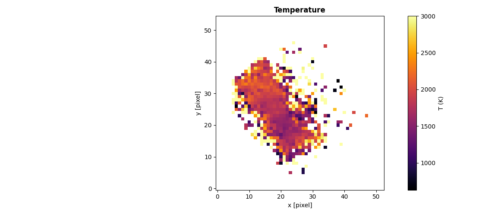

   Temperature map. Median 1892.4 K across fitted pixels (std 587.1 K, range
   629.8-3000 K) -- values that would exceed 3000 K are pinned at that ceiling rather
   than left unbounded.

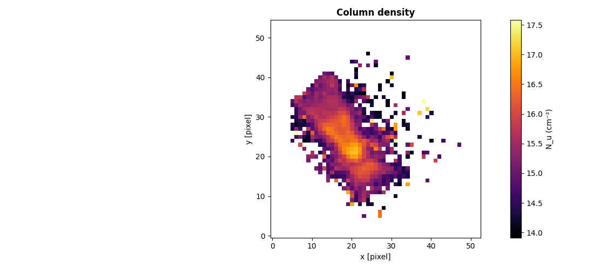

   Column density (N\ :sub:`u`) map, log scale. Median 2.054e+15 cm⁻² (range
   8.196e+13-3.803e+17 cm⁻²).

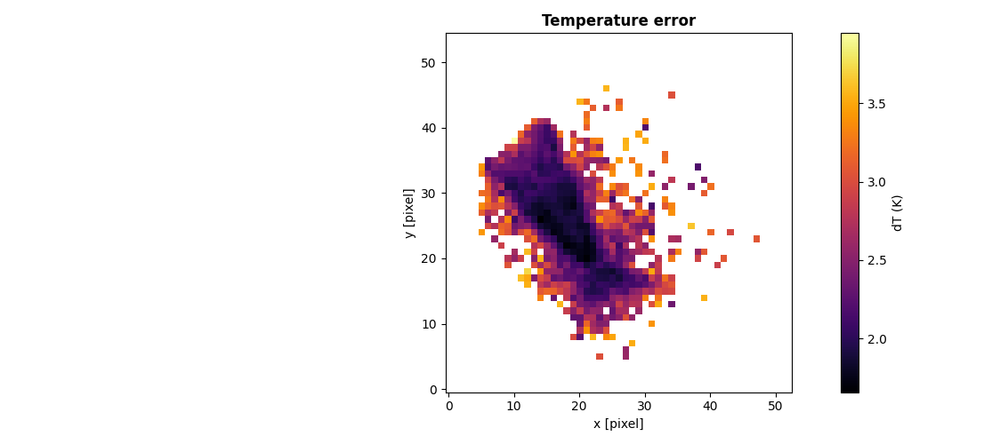

   Temperature uncertainty (dT), log scale.

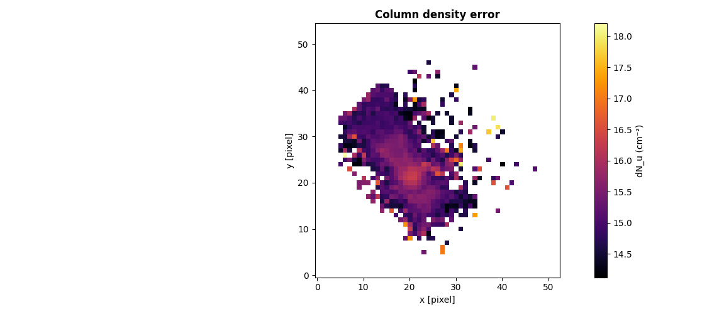

   Column density uncertainty (dN\ :sub:`u`), log scale.

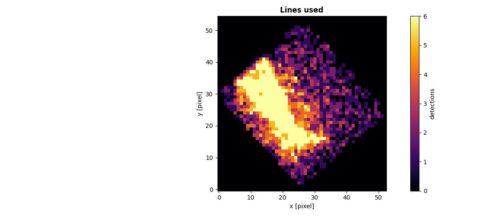

   Lines used per fitted pixel. Median 5.0 (range 3-6) -- the diamond-shaped footprint
   reflects this NIRSpec cube's rotated field of view, not a bug in the fit.

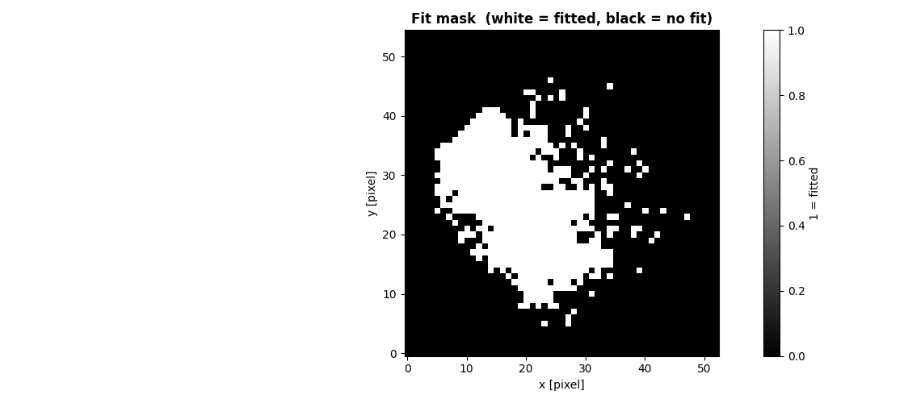

   Fit mask: white = fitted, black = not fitted (no data or too few lines).

**Inspecting a single pixel**

Clicking a pixel on any of the maps above re-fits just that pixel from the per-line flux
maps already built during **Run Map** -- cheap, since it reuses that cached data instead of
redoing any line fitting -- and opens the same style of results plot **Run Fit** shows for
the whole cube.

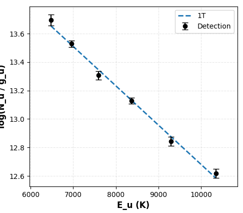

   Pixel (21, 21): T = 1571.5 ± 53.5 K, Ncol = 1.10e+17 ± 1.99e+16 cm⁻², 6 lines used --
   an individual pixel's fit, same style as the whole-cube **Run Fit** plot above.

Using the API
==============

``rotational_diagram()`` is not a separate wrapper — it's the exact function the GUI calls,
imported directly. There's no GUI/API divergence to account for here, unlike flux extraction above.

.. code-block:: python

    from cube_explorer.api import rotational_diagram

    # H2 v=0->0 S(1)-S(7), matching data/H2_lines.csv, matched against HITRAN
    molecular_data = {
        'wavelengths': {1: 17.034846, 2: 12.278612, 3: 9.664911, 4: 8.025041,
                        5: 6.909509, 6: 6.108564, 7: 5.511183},
        'Aul': {1: 4.758e-10, 2: 2.753e-9, 3: 9.83e-9, 4: 2.641e-8,
                5: 5.876e-8, 6: 1.141e-7, 7: 2.0e-7},
        'Eu': {1: 1015.947, 2: 1683.068, 3: 2505.873, 4: 3477.452,
               5: 4589.958, 6: 5834.798, 7: 7202.827},
        'gu': {1: 7, 2: 9, 3: 11, 4: 13, 5: 15, 6: 17, 7: 19},  # bare 2*J_upper+1;
            # apply_OPR() applies the ortho/para nuclear-spin weighting on top of this
    }

    result = rotational_diagram(
        fluxes={1: 178e-16, 2: 55.9e-16, 3: 122e-16, 4: 28.4e-16,
                5: 72.3e-16, 6: 14.4e-16, 7: 22.2e-16},
        flux_errors={1: 9e-16, 2: 3.2e-16, 3: 6.3e-16, 4: 2.4e-16,
                     5: 4e-16, 6: 3.2e-16, 7: 3.8e-16},
        molecular_data=molecular_data,
        R=8.5,      # AU
        dist=71.5,  # pc
        fit2T=True,
    )
    print(f"1T Temperature: {result['1T']['T']:.1f} K")
    print(f"2T Temperatures: {result['2T']['T1']:.1f} K, {result['2T']['T2']:.1f} K")

This reproduces the first worked example above exactly (273.4 K / 863.4 K).

.. important::

   A 2T fit has 4 free parameters, so you need meaningfully more than 4 lines for the fit
   (and its uncertainties) to mean anything. Passing ``fit2T=True`` with too few points
   doesn't raise an error; it just returns a bad fit.

**Run Map, from a script**

``fit_region``, ``fit_pixel``, and ``create_rotational_diagram_map`` are the same functions
the GUI's **Run Fit** / **Run Map** buttons call, for one cube:

.. code-block:: python

    from cube_explorer.api import (
        load_cube, fetch_hitran_data, fit_region, fit_pixel,
        create_rotational_diagram_map, save_rotational_diagram_map_fits, STATUS_OK,
    )

    cube = load_cube("data.fits")
    line_table, _ = fetch_hitran_data(2.87, 5.27, "H2", isotopologue=1, v_upper=1, v_lower=0)

    # Same fit as Run Fit -- sums the whole cube (pass mask=... to sum only some pixels)
    region = fit_region(cube, line_table, min_lines=3)
    if region["status"] == STATUS_OK:
        print(f"Whole-cube T: {region['results']['1T']['T']:.1f} K")

    # One pixel's own fit
    pixel = fit_pixel(cube, 20, 25, line_table, min_lines=3)

    # Same fit as Run Map -- every pixel, run in parallel
    result = create_rotational_diagram_map(cube, line_table, min_lines=3, n_jobs=8)
    save_rotational_diagram_map_fits(result, "rot_diag_map.fits")

On a real NIRSpec cube (37 H2 v=1→0 lines, 55×53 pixels), this fits 877/2915 pixels;
``fit_region`` sums all 2915 into T = 5000.0 ± 138.0 K (pinned at the ceiling -- this
particular v=1→0 hot-band set doesn't constrain a clean rotational diagram the way the
S(1)–S(7) pure-rotational set does above); ``fit_pixel`` at (20, 25) finds 8 lines
individually, one more than the whole-cube sum found.

**Run Map, multiple cubes at different pixel scales**

``fit_region_multi``, ``create_rotational_diagram_map_multi``, and ``fit_pixel_multi`` are
the multi-source equivalents, one line per cube, for cubes of different pixel scale or
shape (see *Creating a Rotational Diagram Map* above for what happens internally):

.. code-block:: python

    from cube_explorer.api import (
        load_cube, create_rotational_diagram_map_multi, fit_pixel_multi, STATUS_OK,
    )

    cubes_and_lines = [
        (load_cube("miri_ch1_long.fits"), {"wavelength": 6.909509, "a_coeff": 4.758e-10,
                                            "e_upper": 1015.947, "Gp": 21,
                                            "branch": "S", "j_lower": 5}),
        (load_cube("miri_ch2_long.fits"), {"wavelength": 10.177803, "a_coeff": 1e-8,
                                            "e_upper": 3000.0, "Gp": 11,
                                            "branch": "S", "j_lower": 3}),
    ]

    result = create_rotational_diagram_map_multi(cubes_and_lines, min_lines=2, n_jobs=4)
    print(f"Common grid: {result['T'].shape}, worst pixel scale: "
          f"{result['worst_pix_arcsec']:.3f} arcsec")

    # Re-fit one pixel from the cached per-line maps instead of rerunning the whole map
    refit = fit_pixel_multi(result, 21, 18, min_lines=2)

Real HH30 MIRI ch1-long/ch2-long data, two H2 lines: the common grid comes out at
37×43 -- different from either input cube's own shape (33×39 and 31×37) -- at the
worst (ch2-long's) pixel scale, 0.170 arcsec. With only 2 lines total and one of them
below the 3σ threshold across most of the field, no pixel here reaches ``STATUS_OK``;
the example is real and runs end-to-end, but this particular line pair is too thin to
constrain a temperature anywhere. A real map needs several well-detected lines per source.

Next Steps
==========

- :doc:`flux_extraction` — a different molecule's line fluxes, fit the same way
- :doc:`gaussian_fitting_cube` — the per-pixel Gaussian fitting **Calculate Fluxes** shares
  its algorithm with
- :doc:`exporting_data` — other export paths
